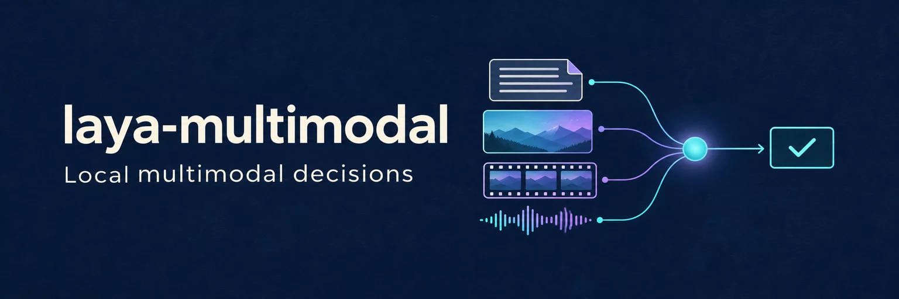
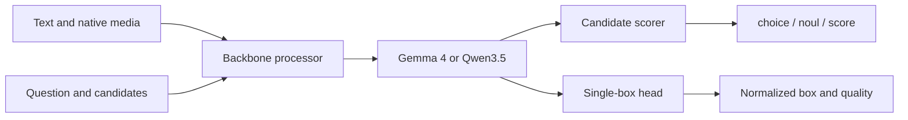

<h1 align="center">laya-multimodal</h1>



A local System 1 decision engine for text, images, video and audio. Each question runs one backbone
forward pass and returns a typed answer with zero generated answer tokens. Use it for routing,
action selection, yes/no checks, ordinal ratings and single-object localization.

| Output | What it returns |
| --- | --- |
| `choice` | The selected candidate and probabilities over the supplied candidates |
| `noul` | The probability that a yes/no condition is true |
| `score` | A distribution over ordered levels and its expected level index |
| `box` | One normalized bounding box for a referred object in an image, with a localization quality score |

| Backbone | Native inputs | Checkpoint |
| --- | --- | --- |
| Qwen3.5 | Text, images and video frames | [JEV Multimodal Qwen3.5-4B · merged native](https://huggingface.co/ZeeoRe/jev-multimodal-qwen3.5-4b) · [GGUF](https://huggingface.co/ZeeoRe/jev-multimodal-qwen3.5-4b-GGUF) |
| Gemma 4 E2B | Text, images, waveform audio and video with optional audio | Train the decision heads on a local backbone |

## Installation

Use Python 3.11 or newer for native models and install from this source checkout. Video processing requires
`ffmpeg` and `ffprobe` on your PATH.

```bash
git clone https://github.com/2351548518/laya.git laya-multimodal
cd laya-multimodal
python -m venv .venv
source .venv/bin/activate
python -m pip install -e '.[multimodal]'
```

Import the package as `laya`. To serve predictions over HTTP, install
`python -m pip install -e '.[multimodal,serve]'`.

On Linux and Apple silicon, `./setup_laya.sh` prepares `.venv-mm` and downloads
the merged Qwen checkpoint shown below. Pass `--skip-models` to use an existing checkpoint.
On Windows, `start.bat` starts the local HTTP service with a downloaded checkpoint.
[Host setup](https://github.com/2351548518/laya/blob/main/LOCAL_SETUP.md)

For a container, mount the local checkpoint and enable the native media dependencies with
`compose.multimodal.yaml`. [Docker setup](https://github.com/2351548518/laya/blob/main/docs/docker.md#serve-a-native-multimodal-checkpoint)

## Quickstart

Download the merged Qwen3.5-4B checkpoint for local CPU or GPU inference.

```bash
hf download ZeeoRe/jev-multimodal-qwen3.5-4b --local-dir models/jev-multimodal-qwen3.5-4b
```

```python
from laya import MultimodalAgent

checkpoint = "models/jev-multimodal-qwen3.5-4b"
agent = MultimodalAgent(checkpoint, device="cuda")
routing_questions = {
    "route": {
        "type": "choice",
        "instructions": "Which team should handle the request?",
        "criteria": {"billing": "invoices and refunds", "technical": "software issues"},
    },
}
decision = agent.predict("I was charged twice for the same invoice.", routing_questions)
print(decision["answers"]["route"])

# Put an image containing a red cup at scene.jpg.
location = agent.predict(
    image="scene.jpg",
    questions={"target": {"type": "box", "instructions": "the red cup"}},
)
print(location["answers"]["target"]["box"])
```

Use `device="cpu"` for CPU inference. For Qwen video, use a state such as
`{"text": "Inspect this clip", "video": "clip.mp4", "video_audio": False}`. A trained Gemma 4
checkpoint also accepts `audio="clip.wav"` or a waveform and `sampling_rate`. The native guide
covers input budgets, batch prediction, local routing and HTTP requests. [Native multimodal guide](https://github.com/2351548518/laya/blob/main/docs/multimodal.md)

From a terminal, use the same native checkpoint for text and media. Set `--multimodal` to select a checkpoint explicitly.

```bash
laya --multimodal models/jev-multimodal-qwen3.5-4b \
  --preset triage "I was charged twice for the same invoice." --json
```

Run the Python example with the downloaded checkpoint. Add `--image scene.jpg` or
`--video clip.mp4` to try local media.

```bash
python examples/native_multimodal.py models/jev-multimodal-qwen3.5-4b --device cpu
```

[Runnable examples](https://github.com/2351548518/laya/tree/main/examples) ·
[Native multimodal notebook](https://github.com/2351548518/laya/blob/main/notebooks/laya_native_multimodal.ipynb) ·
[Native SDK examples](https://github.com/2351548518/laya/blob/main/docs/multimodal-clients.md)

## Train and evaluate

The runtime feeds native media and question tokens into the backbone. A shared candidate scorer
handles decisions, and a compact box head uses the final valid hidden state for localization.



Use JSONL records with an input state, a question, and either a decision target or a single-box
annotation. The starter recipes first train the readouts on a frozen backbone. The Qwen LoRA
stage then updates the readouts, language adapters and visual merger together. The training guide
covers four-GPU training, held-out calibration and evaluation.
[Training guide](https://github.com/2351548518/laya/blob/main/docs/multimodal.md#head-warmup-and-lora-training) ·
[Grounding](https://github.com/2351548518/laya/blob/main/docs/grounding.md) · [Commands](https://github.com/2351548518/laya/blob/main/scripts/multimodal/README.md)

The v6 project guide includes architecture and training diagrams with tensor dimensions, labelled
request examples, and a CPU walkthrough of the supervised losses.
[v6 project guide (Chinese)](https://github.com/2351548518/laya/blob/main/docs/project-readme/index.md)

## GGUF deployment

Use one language GGUF and its matching visual projector with the local llama.cpp-jev runtime.
The selected files below were evaluated after the WebM loading fix on 900 decisions and 128
positive single-box cases. Size includes both files.

| Selected configuration | Size | Decision accuracy | Box Acc@IoU ≥ 0.5 | Harmonic accuracy H |
| --- | ---: | ---: | ---: | ---: |
| Q4_K_M with FP32 heads | 2.902 GiB | 82.78% | 73.44% | 77.83% |
| IQ2_XS / SSM4 with Q8 heads | 1.840 GiB | 81.44% | 71.09% | 75.92% |

H is the harmonic mean of decision and box accuracy. These scores describe the development set
used for model selection. The release guide gives the download pairs, runtime revision and
patch, native export commands and evaluation scope. [Model releases and GGUF setup](https://github.com/2351548518/laya/blob/main/docs/multimodal-release.md)

## Project layout

| Path | Contents |
| --- | --- |
| `laya/` | Inference, native media processing, JSONL loading, training and calibration |
| `assets/` | Project banner, documentation icons and referenced benchmark figures |
| `scripts/multimodal/` | Reusable training, evaluation, merge, conversion and quantization commands |
| `configs/multimodal/` | Portable head warmup and LoRA recipes |
| `sdk/python/`, `sdk/typescript/` | Local HTTP clients for text decisions, media decisions and single-box results |
| `notebooks/`, `examples/` | Runnable native decision examples and JSONL walkthroughs |
| `docs/` and `tests/` | Usage, API contracts and regression checks |
| `examples/clients/` | C++, Rust, .NET, Go and Java examples for the local HTTP service |
| `benchmarks/`, `research/`, `verify/` | Local latency benchmarks, published results and checkpoint smoke tests |
| `Dockerfile`, `compose.*` and `setup_laya.sh` | Local installation and service deployment |
| `start.bat` | Windows launcher for the same native service |

Keep downloaded weights in `models/`, local datasets in `multimodal-data/`, and checkpoints
and reports in `multimodal-runs/`. Use `_local/` for data collection and preparation,
experiments, generated figures and logs. These paths are ignored by Git.

## Development

```bash
python -m pip install -e '.[multimodal,serve]' pytest httpx ruff
ruff check laya/ --select=E9,F63,F7,F82,F401,F811 --line-length=120
python -m compileall -q laya/ tests/
python -m pytest -q tests/test_multimodal.py tests/test_grounding.py \
  tests/test_multimodal_cli.py tests/test_multimodal_export.py
```

The contribution guide covers the full test suite and strict documentation build.
[Contributor setup](https://github.com/2351548518/laya/blob/main/CONTRIBUTING.md)

## Credits and license

laya-multimodal builds on the Laya project by Convai Innovations. `laya.Agent()` and `laya.load()`
select the native decision checkpoint. Install the `vega` extra and call `laya.load(vegaml=True)`
to use the optional local Vega reader. [Upstream Laya](https://github.com/NandhaKishorM/laya)

The source is licensed under [Apache 2.0](https://github.com/2351548518/laya/blob/main/LICENSE). The base models and datasets retain their
respective licenses. For the original research, see [From Laya to Vega](https://doi.org/10.20944/preprints202611.0781.v1).
