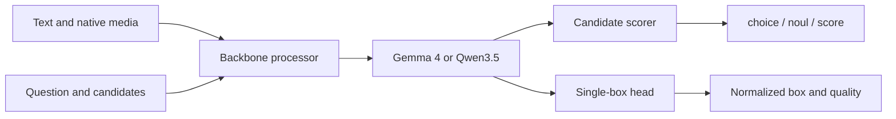

# laya-multimodal


A local System 1 decision engine for text, images, video and audio. Each question runs one backbone
forward pass and returns a typed answer with zero generated answer tokens. Use it for routing,
action selection, yes/no checks, ordinal ratings and single-object localization.

| Output | What it returns |
| --- | --- |
| `choice` | The selected candidate and probabilities over the supplied candidates |
| `noul` | The probability that a yes/no condition is true |
| `score` | A distribution over ordered levels and its expected level index |
| `box` | One normalized bounding box for a referred object in an image, with a localization quality score |

| Backbone | Native inputs | Checkpoint |
| --- | --- | --- |
| Qwen3.5 | Text, images and video frames | [JEV Multimodal Qwen3.5-4B · merged native](https://huggingface.co/ZeeoRe/jev-multimodal-qwen3.5-4b) · [GGUF](https://huggingface.co/ZeeoRe/jev-multimodal-qwen3.5-4b-GGUF) |
| Gemma 4 E2B | Text, images, waveform audio and video with optional audio | Train the decision heads on a local backbone |

## Installation

Use Python 3.10 or newer and install from this source checkout. Video processing requires
`ffmpeg` and `ffprobe` on your PATH.

```bash
git clone https://github.com/2351548518/laya.git laya-multimodal
cd laya-multimodal
python -m venv .venv
source .venv/bin/activate
python -m pip install -e '.[multimodal]'
```

The Python package is imported as `laya`. The HTTP server is available with
`python -m pip install -e '.[multimodal,serve]'`.

On Linux and Apple silicon, `./setup_laya.sh --multimodal` prepares `.venv-mm` and downloads
the merged Qwen checkpoint shown below. Pass `--skip-models` to use an existing checkpoint.

For a container, mount the local checkpoint and enable the native media dependencies with
`compose.multimodal.yaml`. [Docker setup](https://github.com/2351548518/laya/blob/main/docs/docker.md#serve-a-native-multimodal-checkpoint)

## Quickstart

Download the merged Qwen3.5-4B checkpoint. After the download, prediction uses local files and
can run on your own CPU or GPU.

```bash
hf download ZeeoRe/jev-multimodal-qwen3.5-4b --local-dir models/jev-multimodal-qwen3.5-4b
```

```python
from laya import MultimodalAgent

agent = MultimodalAgent("models/jev-multimodal-qwen3.5-4b", device="cuda")
questions = {
    "route": {
        "type": "choice",
        "instructions": "Which team should handle the request?",
        "criteria": {"billing": "invoices and refunds", "technical": "software issues"},
    },
}
out = agent.predict("I was charged twice for the same invoice.", questions)
print(out["answers"]["route"])

# Use your own image and refer to one object.
out = agent.predict(
    image="scene.jpg",
    questions={"target": {"type": "box", "instructions": "the red cup"}},
)
print(out["answers"]["target"]["box"])
```

Use `device="cpu"` for CPU inference. For Qwen video, use a state such as
`{"text": "Inspect this clip", "video": "clip.mp4", "video_audio": False}`. A trained Gemma 4
checkpoint also accepts `audio="clip.wav"` or a waveform and `sampling_rate`. The native guide
covers input budgets, batch prediction, local routing and HTTP requests. [Native multimodal guide](https://github.com/2351548518/laya/blob/main/docs/multimodal.md)

Use the [native Notebook](https://github.com/2351548518/laya/blob/main/notebooks/laya_native_multimodal.ipynb)
to try text and media decisions and inspect the JSONL format. For a separate application process,
the Python and TypeScript SDKs send media to your local server. [Native SDK examples](https://github.com/2351548518/laya/blob/main/docs/multimodal-clients.md)

## Train and evaluate

The runtime feeds native media and question tokens into the backbone. A shared candidate scorer
handles decisions, and a compact box head uses the final valid hidden state for localization.



Train on JSONL rows containing input state, questions and decision targets or a single-box
annotation. The starter recipes warm up the readouts and then train the readouts, language LoRA
and the Qwen visual merger. The training guide includes four-GPU commands, a decision-only CLI,
held-out calibration and evaluation. [Training guide](https://github.com/2351548518/laya/blob/main/docs/multimodal.md#head-warmup-and-lora-training) ·
[Grounding](https://github.com/2351548518/laya/blob/main/docs/grounding.md) · [Commands](https://github.com/2351548518/laya/blob/main/scripts/multimodal/README.md)

## GGUF deployment

Use one language GGUF and its matching visual projector with the local llama.cpp-jev runtime.
The selected files below were evaluated after the WebM loading fix on 900 decisions and 128
positive single-box cases. Size includes both files.

| Selected configuration | Size | Decision accuracy | Box Acc@IoU ≥ 0.5 | Harmonic accuracy H |
| --- | ---: | ---: | ---: | ---: |
| Q4_K_M with FP32 heads | 2.902 GiB | 82.78% | 73.44% | 77.83% |
| IQ2_XS / SSM4 with Q8 heads | 1.840 GiB | 81.44% | 71.09% | 75.92% |

H is the harmonic mean of decision and box accuracy. These scores describe the development set
used for model selection. The release guide gives the download pairs, runtime revision and
patch, native export commands and evaluation scope. [Model releases and GGUF setup](https://github.com/2351548518/laya/blob/main/docs/multimodal-release.md)

## Project layout

| Path | Contents |
| --- | --- |
| `laya/` | Inference, native media processing, JSONL loading, training and calibration |
| `scripts/multimodal/` | Reusable training, evaluation, merge, conversion and quantization commands |
| `configs/multimodal/` | Portable head warmup and LoRA recipes |
| `sdk/python/`, `sdk/typescript/` | Local HTTP clients for text decisions, media decisions and single-box results |
| `notebooks/`, `examples/` | Native multimodal walkthrough and classic checkpoint examples |
| `docs/` and `tests/` | Usage, API contracts and regression checks |
| `laya-cpp/`, `laya-rust/`, `laya-dotnet/`, `laya-go/`, `laya-java/`, `laya-ts/` | Classic Laya text runtimes and instructions for calling the local multimodal services |
| `benchmarks/`, `research/`, `verify/` | Evaluation recipes, published result records and local runtime checks |
| `Dockerfile`, `compose.*` and `setup_laya.sh` | Local installation and service deployment |

Keep downloaded weights in `models/`, local datasets in `multimodal-data/`, and checkpoints
and reports in `multimodal-runs/`. Use `_local/` for data collection and preparation,
experiments, generated figures and logs. These paths are ignored by Git.

## Development

```bash
python -m pip install -e '.[multimodal,serve]' pytest httpx ruff
ruff check laya/ --select=E9,F63,F7,F82,F401,F811 --line-length=120
python -m compileall -q laya/ tests/
python -m pytest -q tests/test_multimodal.py tests/test_grounding.py tests/test_multimodal_export.py
```

See the [contribution guide](https://github.com/2351548518/laya/blob/main/CONTRIBUTING.md) for the full suite and the documentation build.

## Credits and license

laya-multimodal extends the Laya project by Convai Innovations. The upstream project documents
the original text decision models, SDKs and Vega integration. This fork follows upstream Laya
0.5.3: bare `laya.Agent()` and `laya.load()` use Vega. Use `vegaml=False` to select the classic
encoder and `laya.MultimodalAgent(...)` to load a native decision checkpoint.
[Laya text routing and integrations](https://github.com/2351548518/laya/blob/main/docs/laya-guide.md) · [Upstream Laya](https://github.com/NandhaKishorM/laya)

The source is licensed under [Apache 2.0](https://github.com/2351548518/laya/blob/main/LICENSE). The base models and datasets retain their
respective licenses. For the original research, see [From Laya to Vega](https://doi.org/10.20944/preprints202611.0781.v1).
