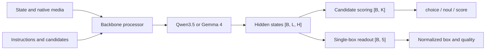

<h1 align="center">laya-multimodal</h1>

**English** · [简体中文](README_zh.md)


A local System 1 decision engine for routing, action selection, checks, ratings and single-object
localization. It reads text and native media, and returns typed decisions with zero generated
answer tokens.

[Install](#installation) · [Directory structure](#directory-structure) · [Model architecture](#model-architecture) · [Inference](#local-inference) · [Training](#training) · [Evaluation and tests](#evaluation-and-tests) · [Deployment](#deployment)

[Documentation](docs/index.md)

| Output | What it returns |
| --- | --- |
| `choice` | The selected candidate and a probability distribution over the options |
| `noul` | The probability that the condition is true |
| `score` | The probability distribution over ordered levels and its expected level index |
| `box` | One image box with normalized `left`, `top`, `right` and `bottom` coordinates and an IoU quality estimate |

| Backbone | Supported inputs | Checkpoint |
| --- | --- | --- |
| Qwen3.5-4B | Text, images and visual video frames | [Merged native v1](https://huggingface.co/ZeeoRe/jev-multimodal-qwen3.5-4b) · [Quantized GGUF](https://huggingface.co/ZeeoRe/jev-multimodal-qwen3.5-4b-GGUF) |
| Gemma 4 E2B | Text, images, waveform audio and video with optional audio | Train the decision heads on a local backbone |

## Installation

Use Python 3.11 or newer. Install `ffmpeg` and `ffprobe` for video input.

```bash
git clone https://github.com/2351548518/laya.git laya-multimodal
cd laya-multimodal
python3 -m venv .venv
source .venv/bin/activate
python -m pip install -e '.[multimodal]'
```

Import `laya_multimodal` in Python and run `laya-multimodal` from a terminal.
The same command provides the `train` and `eval` subcommands. On Linux and Apple silicon,
`./setup_laya.sh` creates `.venv-mm` and downloads the merged checkpoint.
Pass `--skip-models` to use an existing checkpoint. [Host setup](LOCAL_SETUP.md)

## Directory structure

```text
laya_multimodal/
    __init__.py, cli.py         Python exports and terminal command
    train.py, serve.py          Joint training and HTTP service
    data.py                     Native JSONL, supervision and batch collation
    models/                     Backbones, media processing, decision readouts and Box heads
    decisions/                  Question schemas, routing, confidence and System One
    training/                   Losses, LoRA, distributed updates, snapshots and logging
    evaluation/                 Native metrics, agreement, shortlist, tournament and regression gates
    integrations/               Framework adapters and tool selection
        shared/                 Request options, decision responses and adapter errors
    mcp/                        MCP server and decision tools
configs/                       Serving, head warmup and LoRA configurations
scripts/multimodal/             Data preparation, evaluation, calibration and export
benchmarks/, verify/            Latency reports and native checkpoint smoke checks
research/                       Evaluation fixtures, audit code and historical results
sdk/python/, sdk/typescript/     HTTP clients
examples/, notebooks/            Local inference examples and training walkthroughs
tests/                          Runtime, training, packaging and API regression tests
docs/, docs_zh/, assets/         English and Chinese guides, diagrams and project artwork
Dockerfile, compose*.yaml       CPU, NVIDIA CUDA and DGX Spark deployment
setup_laya.sh, start.bat        Host setup and Windows service launcher
```

Ordinary Python module names start with a lowercase letter and use `snake_case`.
Each framework has its own adapter module. Shared adapter code lives in `integrations/shared/`,
and public classes are exported from `laya_multimodal.integrations`.

`decisions/calibration.py` fits reusable probability calibrators.
`models/modality_calibration.py` fits per-modality temperatures and ordinal calibration.
`evaluation/native_metrics.py` collects and scores native checkpoint decisions.

Local weights go in `models/`, prepared data in `multimodal-data/`, and training checkpoints
and reports in `multimodal-runs/`. Use `_local/` for temporary experiments. Git ignores these
directories.

## Model architecture



1. The backbone processor turns the request into text tokens and supported image, video or audio
   features. The backbone contextualizes the question and its inputs together.
2. The candidate scorer uses the final decision state as a query and gathers candidate states at
   their prompt positions. Two 256-dimensional projections and a scaled normalized dot product
   yield one logit per candidate. The decoder restores the original option order before returning
   probabilities. For `score`, the reported value is the expected level index.
3. The grounding head reads the final valid state and predicts four coordinates and a quality logit.
   Coordinates are ordered and normalized to the image. The quality score estimates target overlap.

Here `B` is batch size, `L` is sequence length, `H` is backbone hidden width and `K` is candidate
count. Qwen3.5-4B uses `H = 2560`. Each question is scored directly from the backbone activations.
[Architecture with tensor dimensions](docs/project-readme/assets/architecture.en.svg) · [Model and loss walkthrough](docs/project-readme/multimodal-current.md)

## Local inference

Download the published native decision checkpoint.

```bash
hf download ZeeoRe/jev-multimodal-qwen3.5-4b --local-dir models/jev-multimodal-qwen3.5-4b
```

Run a text decision and a box prediction with the same agent. For the box example, put a photo
containing a red cup at `scene.jpg`.

```python
from laya_multimodal import MultimodalAgent

agent = MultimodalAgent("models/jev-multimodal-qwen3.5-4b", device="cpu")
result = agent.predict(
    "I was charged twice for the same invoice.",
    {"team": {
        "type": "choice",
        "instructions": "Which team should handle this request?",
        "criteria": {"billing": "invoices and refunds", "support": "product help"},
    }},
)
print(result["answers"]["team"])

location = agent.predict(
    image="scene.jpg",
    questions={"target": {"type": "box", "instructions": "the red cup"}},
)
print(location["answers"]["target"]["box"])
```

Select `device="cuda:0"` for GPU inference. Pass a local video as
`{"text": "Inspect the clip", "video": "clip.mp4", "video_audio": False}` for visual-only Qwen input.
With a trained audio-capable Gemma checkpoint, pass `audio="clip.wav"` or a waveform and
`sampling_rate`. [Input formats and budgets](docs/multimodal.md#local-prediction)

The CLI can route a request or run a prediction against a selected checkpoint.

```bash
laya-multimodal --explain --json "I was charged twice."
laya-multimodal --multimodal models/jev-multimodal-qwen3.5-4b \
  --preset triage --json "I was charged twice."
```

[Runnable examples](examples/README.md) · [Notebook](notebooks/laya_native_multimodal.ipynb)

## Training

### Prepare separate JSONL splits

Start with local JSONL containing one question per row under `questions`, with its input under
`state`. Use `expected` for a label, Boolean or score, and `gold` for an annotated probability
distribution. The example below supplies a label for `team`.

```json
{"id":"billing-1","state":"I was charged twice.","questions":{"team":{"type":"choice","instructions":"Which team should handle this request?","criteria":{"billing":"invoices and refunds","support":"product help"}}},"expected":{"team":"billing"}}
```

For localization, put the image path in `state` and the normalized box
`[left, top, right, bottom]` in `grounding.boxes`. Relative media paths start at the source JSONL
file's directory.

```json
{"id":"cup-1","state":{"image":"scene.jpg"},"questions":{"target":{"type":"box","instructions":"the red cup"}},"grounding":{"task":"single","boxes":[[0.2,0.3,0.7,0.8]]}}
```

Convert those rows into the training, head warmup, development and held-out test files.
Put localization examples in `dev` and decision examples in `decision_dev`.
The `train`, `warmup` and `test` files can include both.

```bash
data=multimodal-data/example/native
python scripts/multimodal/prepare_dataset.py --training \
  --split train=path/to/train.jsonl --split warmup=path/to/warmup.jsonl \
  --split dev=path/to/box-dev.jsonl --split decision_dev=path/to/decision-dev.jsonl \
  --split test=path/to/test.jsonl --out "$data"
```

The prepared rows use the System One `request` envelope. The text example becomes the record below.
The image example uses a named image under `request.assets` and a path under `media_files`.

```json
{"id":"billing-1","request":{"model":"multimodal","state":"I was charged twice.","questions":{"team":{"type":"choice","instructions":"Which team should handle this request?","criteria":{"billing":"invoices and refunds","support":"product help"}}}},"expected":{"team":"billing"}}
```

Use visual-only media rows for Qwen, with `video_audio: false` for video. Keep the final
test set separate from training, checkpoint selection and calibration.
[Data contracts and examples](docs/multimodal.md#local-jsonl-data-loading)

### Warm up the heads and fine-tune

The first stage freezes the original backbone and trains the candidate and single-box readouts.
The second stage starts from the selected warmup checkpoint with a new optimizer and LoRA adapters.
For Qwen, the starter LoRA recipe updates language adapters, the visual merger and both readouts
while the visual encoder stays frozen. The joint objective combines supervised decision losses
with coordinate L1, GIoU and box quality losses.

The following example uses four available NVIDIA GPUs, an original local Qwen backbone and the
splits prepared above. Set `CUDA_VISIBLE_DEVICES` to the four GPUs you want to use. The starter
recipes use a global batch of 64 records, with separate budgets for the context length and padded
microbatch. Each stage writes the selected checkpoint path to `training_report.json`.

```bash
base=models/pretrained/Qwen3.5-4B
data=multimodal-data/example/native
run=multimodal-runs/example

torchrun --standalone --nproc_per_node=4 --module laya_multimodal.train \
  --model "$base" --data "$data" --train-split warmup --out "$run/head" \
  --config configs/head.json --visual-only --require-original-base --allow-unadmitted

warmup_checkpoint=$(python -c 'import json, sys; print(json.load(sys.stdin)["checkpoint"])' \
  < "$run/head/training_report.json")
torchrun --standalone --nproc_per_node=4 --module laya_multimodal.train \
  --model "$warmup_checkpoint" --data "$data" --out "$run/sft" \
  --config configs/sft.json --visual-only --allow-unadmitted
```

Use `--allow-unadmitted` for local examples prepared without processor admission records. The v6
recipe uses admitted rows checked against the original Qwen processor. For audio-capable training,
use a Gemma 4 backbone and an audio-capable dataset without the `--visual-only` flag.
[Training diagram](docs/project-readme/assets/training.en.svg) · [v6 reproduction and resume](docs/project-readme/multimodal.md)

Run `laya-multimodal train --help` for settings. Enable `checkpoint_every` in the recipe to
save recoverable training snapshots, and resume using the original settings with `--resume`.
Install `.[multimodal,swanlab]` and set `--swanlab local` for local metrics. After authenticating
with SwanLab, use `--swanlab online --swanlab-project PROJECT` for an online dashboard.
[Detailed training guide](docs/finetune.md)

## Evaluation and tests

Evaluate the selected checkpoint on a held-out suite. The evaluator validates the suite against
its manifest and writes a separate JSON report.

```bash
checkpoint=$(python -c 'import json, sys; print(json.load(sys.stdin)["checkpoint"])' \
  < multimodal-runs/example/sft/training_report.json)
python scripts/multimodal/evaluate.py --model "$checkpoint" \
  --suite-manifest multimodal-data/example/native/manifest.json --suite test \
  --device cuda:0 --out multimodal-runs/example/test.json
```

Decision reports include accuracy by modality and question type, NLL, Brier and ECE. Ordinal
decisions also report error across levels. Localization reports include mean IoU and accuracy
at IoU ≥ 0.5. Compare checkpoints on identical labelled rows and input budgets. Fit probability
calibration on separate calibration data before running the final test.
[Evaluation protocol and release metrics](BENCHMARKS.md) · [Text evaluation and baseline comparison](docs/evals.md)

Use the latency benchmark to record the first call, median and P95 on fixed requests. Use the
smoke checker to verify the local checkpoint's answer structure and token accounting.
[Latency commands](benchmarks/README.md) · [Smoke checks](verify/README.md)

Run the repository checks from the root.

```bash
python -m pip install -e '.[multimodal,serve,mcp,langchain]' pytest httpx ruff
ruff check laya_multimodal/ --select=E9,F63,F7,F82,F401,F811 --line-length=120
python -m compileall -q laya_multimodal/ tests/
python scripts/test_suites.py
python -m pytest -q tests/test_evals.py tests/test_evals_shortlist.py
```

[Contribution and documentation checks](CONTRIBUTING.md)

## Deployment

### Local HTTP service

Install the server extra and start the service.

```bash
python -m pip install -e '.[multimodal,serve]'
export LAYA_MULTIMODAL_MODEL="$PWD/models/jev-multimodal-qwen3.5-4b"
LAYA_HOST=127.0.0.1 LAYA_DEVICE=cpu LAYA_PRELOAD=0 laya-multimodal-serve
```

Send a health check and a text request from another terminal.

```bash
curl -fsS http://127.0.0.1:8000/health
curl -fsS http://127.0.0.1:8000/v1/systemone \
  -H 'Content-Type: application/json' --data-binary @examples/docker/request.json
```

| Endpoint | Use |
| --- | --- |
| `GET /v1/models` | List deployed model names and the default alias |
| `POST /v1/systemone` | Text decisions and named PNG or JPEG assets, including a single box |
| `POST /v1/systemone/batch` | Multiple states with shared questions |
| `POST /v1/multimodal` | One inline image, audio file or video with optional text context |
| `POST /v1/route` | Inspect checkpoint routing |
| `GET /health` | Check service liveness |

Use `jev-mm-latest` to select the default checkpoint. Set `LAYA_SERVE_CONFIG=configs/serve.json`
and point its Qwen and Gemma entries to your checkpoints to serve both. Named images use the
System One asset format and image header. Set `LAYA_API_KEY` to require bearer authentication.
The Python and TypeScript SDKs handle request encoding and response validation.
Install `.[multimodal,mcp]` and run `laya-multimodal-mcp-server` for an MCP client.
On Windows, `start.bat` launches the native HTTP service.
[Wire format and limits](docs/http-api.md) · [SDK examples](docs/multimodal-clients.md) · [MCP setup](docs/cli-mcp.md)

### Docker

Mount an existing merged checkpoint read-only and serve it offline.

```bash
export LAYA_MULTIMODAL_MODEL_DIR="$PWD/models/jev-multimodal-qwen3.5-4b"
docker compose -f compose.yaml -f compose.http.yaml -f compose.multimodal.yaml \
  up --build laya-multimodal-serve
```

The base configuration uses CPU wheels. Add `-f compose.cuda.yaml` for NVIDIA CUDA or
`-f compose.spark.yaml` for DGX Spark. Set `LAYA_GPU_ID` to choose a GPU and
`LAYA_PORT` to change the service port. The one-shot service is named `laya-multimodal`.
[Platform and driver requirements](docs/docker.md)

### GGUF on a local runtime

Use the llama.cpp-jev fork with a language GGUF and its matching `mmproj` for visual inputs.
The release guide includes the tested runtime revision, build commands, the exact file pairs
and sample requests.

| Configuration | Total size | Decision accuracy | Box Acc@IoU ≥ 0.5 | Harmonic accuracy H |
| --- | ---: | ---: | ---: | ---: |
| Q4_K_M with FP32 heads | 2.902 GiB | 82.78% | 73.44% | 77.83% |
| IQ2_XS / SSM4 with Q8 heads | 1.840 GiB | 81.44% | 71.09% | 75.92% |

These v1 results use 900 decision examples and 128 positive boxes from the
model-selection development set. Total size includes the visual projector.
[Model files, conversion and runtime setup](docs/multimodal-release.md)

## Credits and license

The project builds on [Laya by Convai Innovations](https://github.com/NandhaKishorM/laya).
An optional local Vega reader is available through the `vega` extra and
`laya_multimodal.load(vegaml=True)`. [From Laya to Vega](https://doi.org/10.20944/preprints202611.0781.v1)

The source uses the [Apache 2.0 license](LICENSE). Base models and datasets retain their
respective licenses.
