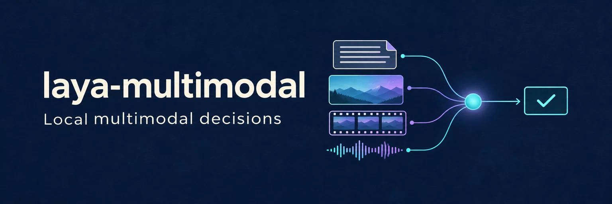
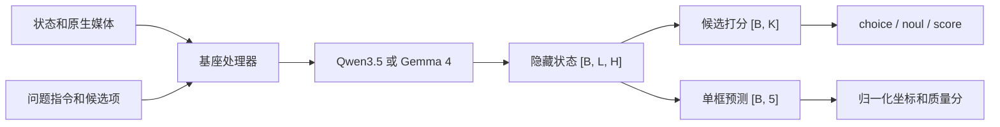

<h1 align="center">laya-multimodal</h1>

[English](README.md) · **简体中文**



laya-multimodal 是一个本地 System 1 决策引擎，可用于请求路由、动作选择、条件判断、等级评分和单目标定位。
模型读取文本和原生媒体，直接返回结构化决策，生成的答案 token 数为零。

[安装](#安装) · [目录结构](#目录结构) · [模型架构](#模型架构) · [本地推理](#本地推理) · [训练](#训练) · [评测和测试](#评测和测试) · [部署](#部署)

[文档](docs_zh/index.md)

| 输出类型 | 返回值 |
| --- | --- |
| `choice` | 选中的候选项及各候选项的概率 |
| `noul` | 条件成立的概率 |
| `score` | 有序等级上的概率分布和等级索引的期望值 |
| `box` | 一个图像框，包含归一化的 `left`、`top`、`right`、`bottom` 坐标和 IoU 质量估计 |

| 基座 | 支持的输入 | 检查点 |
| --- | --- | --- |
| Qwen3.5-4B | 文本、图片、视频画面 | [合并后的原生 v1](https://huggingface.co/ZeeoRe/jev-multimodal-qwen3.5-4b) · [GGUF 量化版](https://huggingface.co/ZeeoRe/jev-multimodal-qwen3.5-4b-GGUF) |
| Gemma 4 E2B | 文本、图片、音频波形和可带音轨的视频 | 在本地基座上训练决策头 |

## 安装

使用 Python 3.11 或更新版本。处理视频需要安装 `ffmpeg` 和 `ffprobe`。

```bash
git clone https://github.com/2351548518/laya.git laya-multimodal
cd laya-multimodal
python3 -m venv .venv
source .venv/bin/activate
python -m pip install -e '.[multimodal]'
```

Python 导入名为 `laya_multimodal`，终端命令为 `laya-multimodal`，包含 `train` 和
`eval` 子命令。在 Linux 和 Apple 芯片的 macOS 上，`./setup_laya.sh` 会创建 `.venv-mm` 并
下载合并后的检查点。已有检查点时可以传入 `--skip-models`。[本地安装指南](LOCAL_SETUP.md)

## 目录结构

```text
laya_multimodal/
    __init__.py, cli.py         Python 导出与终端命令
    train.py, serve.py          联合训练与 HTTP 服务
    data.py                     原生 JSONL、标签和批次拼接
    models/                     基座、媒体处理、决策读出和单框定位
    decisions/                  题型、路由、置信度和 System One
    training/                   损失、LoRA、跨卡更新、快照与日志
    evaluation/                 原生指标、一致性、候选评测和回归门槛
    integrations/               框架适配与工具选择
        shared/                 公用的请求参数、决策响应与异常
    mcp/                        MCP 服务与决策工具
configs/multimodal/             头部预热和 LoRA 示例配置
scripts/multimodal/             数据准备、评测、校准和模型导出
benchmarks/, verify/            延迟基准和原生检查点冒烟测试
research/                       评测样例、审计代码和历史结果
sdk/python/, sdk/typescript/     HTTP 客户端
examples/, notebooks/            本地推理示例和训练演示
tests/                          运行时、训练、打包和 API 回归测试
docs/, docs_zh/, assets/         中英文指南、架构图和项目图片
Dockerfile, compose*.yaml       CPU、NVIDIA CUDA 和 DGX Spark 部署
setup_laya.sh, start.bat        本机安装和 Windows 服务启动脚本
```

普通 Python 模块以小写字母开头，采用 `snake_case`。各框架使用独立的适配文件，共用代码放在
`integrations/shared/`。公开类从 `laya_multimodal.integrations` 导入。

`decisions/calibration.py` 提供通用概率校准。
`models/modality_calibration.py` 拟合各模态的温度及序数校准。
`evaluation/native_metrics.py` 收集原生检查点的决策并计算指标。

本地权重放在 `models/`，准备好的数据放在 `multimodal-data/`，训练检查点和报告放在
`multimodal-runs/`，临时实验放在 `_local/`。这些目录都在 Git 忽略范围内。

## 模型架构



1. 基座处理器将请求转换成文本 token 和模型支持的图片、视频或音频特征。基座联合编码输入与问题。
2. 候选打分头以最后一个决策状态作查询，并从提示中每个候选标记的位置取出对应状态。通过两路
   256 维投影和带缩放的归一化点积，得到每个候选的 logit。解码时恢复原选项顺序，再返回概率。
   `score` 返回等级索引的期望值。
3. 定位头读取最后一个有效状态，预测四个坐标和一个质量 logit。坐标排序后归一化到图像，质量分
   用来估计预测框与目标框的重合程度。

`B` 为批量大小，`L` 为序列长度，`H` 为基座隐藏维度，`K` 为候选数量。Qwen3.5-4B 的
`H = 2560`。每道题直接从基座的隐藏状态得到分数。
[含张量维度的架构图](docs/project-readme/assets/architecture.svg) · [模型和损失详解](docs_zh/project-readme/multimodal-current.md)

## 本地推理

先下载已发布的原生决策检查点。

```bash
hf download ZeeoRe/jev-multimodal-qwen3.5-4b --local-dir models/jev-multimodal-qwen3.5-4b
```

用同一个 Agent 运行文本决策和图片定位。定位示例需要在 `scene.jpg` 放一张含有红杯子的照片。

```python
from laya_multimodal import MultimodalAgent

agent = MultimodalAgent("models/jev-multimodal-qwen3.5-4b", device="cpu")
result = agent.predict(
    "I was charged twice for the same invoice.",
    {"team": {
        "type": "choice",
        "instructions": "Which team should handle this request?",
        "criteria": {"billing": "invoices and refunds", "support": "product help"},
    }},
)
print(result["answers"]["team"])

location = agent.predict(
    image="scene.jpg",
    questions={"target": {"type": "box", "instructions": "the red cup"}},
)
print(location["answers"]["target"]["box"])
```

使用 GPU 时可设为 `device="cuda:0"`。Qwen 可传入
`{"text": "Inspect the clip", "video": "clip.mp4", "video_audio": False}` 读取视频画面。
具备音频能力的 Gemma 检查点可接收 `audio="clip.wav"`，也可接收音频波形和 `sampling_rate`。
[输入格式和 token 预算](docs_zh/multimodal.md#local-prediction)

CLI 可以查看路由，也可以用指定的检查点完成决策。

```bash
laya-multimodal --explain --json "I was charged twice."
laya-multimodal --multimodal models/jev-multimodal-qwen3.5-4b \
  --preset triage --json "I was charged twice."
```

[可运行示例](examples/README.md) · [Notebook](notebooks/laya_native_multimodal.ipynb)

## 训练

### 准备 JSONL 数据分片

原始 JSONL 每行放一道题，`questions` 存问题，`state` 存输入。`expected` 可存候选标签、
布尔值或分数，`gold` 用于标注的概率分布。下面的例子为 `team` 提供候选标签。

```json
{"id":"billing-1","state":"I was charged twice.","questions":{"team":{"type":"choice","instructions":"Which team should handle this request?","criteria":{"billing":"invoices and refunds","support":"product help"}}},"expected":{"team":"billing"}}
```

定位样本在 `state` 中放图片路径，在 `grounding.boxes` 中放归一化的
`[left, top, right, bottom]` 坐标。相对媒体路径从原始 JSONL 文件所在目录解析。

```json
{"id":"cup-1","state":{"image":"scene.jpg"},"questions":{"target":{"type":"box","instructions":"the red cup"}},"grounding":{"task":"single","boxes":[[0.2,0.3,0.7,0.8]]}}
```

将已标注样本转换为训练、头部预热、开发和最终测试分片。`dev` 存定位样本，
`decision_dev` 存决策样本。`train`、`warmup` 和 `test` 可以同时包含两类样本。

```bash
data=multimodal-data/example/native
python scripts/multimodal/prepare_dataset.py --training \
  --split train=path/to/train.jsonl --split warmup=path/to/warmup.jsonl \
  --split dev=path/to/box-dev.jsonl --split decision_dev=path/to/decision-dev.jsonl \
  --split test=path/to/test.jsonl --out "$data"
```

转换后的记录使用 System One `request` 结构。下面是文本样本的转换结果。图片样本在
`request.assets` 中绑定命名图片，在 `media_files` 中记录本地路径。

```json
{"id":"billing-1","request":{"model":"multimodal","state":"I was charged twice.","questions":{"team":{"type":"choice","instructions":"Which team should handle this request?","criteria":{"billing":"invoices and refunds","support":"product help"}}}},"expected":{"team":"billing"}}
```

Qwen 的视频训练行指定 `video_audio: false`，使用画面作为输入。最终测试集独立于训练、
检查点选择和校准。[数据契约与样例](docs_zh/multimodal.md#local-jsonl-data-loading)

### 头部预热与 LoRA 微调

第一阶段冻结原始基座，训练候选打分头和单框定位头。第二阶段从选中的预热检查点出发，
重新建立优化器和 LoRA 适配器。Qwen 的示例配置更新语言适配器、视觉 merger 和两个头部，
视觉编码器保持冻结。联合目标包括决策监督损失、框坐标 L1 损失、GIoU 损失和质量损失。

以下示例使用四张空闲 NVIDIA 显卡、原始本地 Qwen 基座和上一步的数据。通过
`CUDA_VISIBLE_DEVICES` 指定要使用的四张卡。示例配置的全局 batch 为 64 条，单条输入的
上下文预算与补齐后的微批预算分别配置。每个阶段会把选中的检查点路径写入 `training_report.json`。

```bash
base=models/pretrained/Qwen3.5-4B
data=multimodal-data/example/native
run=multimodal-runs/example

torchrun --standalone --nproc_per_node=4 --module laya_multimodal.train \
  --model "$base" --data "$data" --train-split warmup --out "$run/head" \
  --config configs/multimodal/head.json --visual-only --require-original-base --allow-unadmitted

warmup_checkpoint=$(python -c 'import json, sys; print(json.load(sys.stdin)["checkpoint"])' \
  < "$run/head/training_report.json")
torchrun --standalone --nproc_per_node=4 --module laya_multimodal.train \
  --model "$warmup_checkpoint" --data "$data" --out "$run/sft" \
  --config configs/multimodal/sft.json --visual-only --allow-unadmitted
```

没有处理器准入记录的本地示例可使用 `--allow-unadmitted`。v6 配方使用经原始 Qwen 处理器
核验的训练行。训练包含音频的模型时，可使用具备音频能力的 Gemma 4 基座和对应数据集，
省略 `--visual-only`。[训练流程图](docs/project-readme/assets/training.svg) · [v6 复现与续训](docs_zh/project-readme/multimodal.md)

用 `laya-multimodal train --help` 查看配置参数。在配方里设置 `checkpoint_every`
可定期保存恢复快照，续训时用原有设置并传入 `--resume`。安装 `.[multimodal,swanlab]` 后，
训练可通过 `--swanlab local` 记录本地指标，或在登录 SwanLab 后用
`--swanlab online --swanlab-project PROJECT` 在网页查看。
[详细训练指南](docs_zh/finetune.md)

## 评测和测试

在独立测试分片上评估选中的检查点。评测器会核对清单中的数据校验值，并输出独立的 JSON 报告。

```bash
checkpoint=$(python -c 'import json, sys; print(json.load(sys.stdin)["checkpoint"])' \
  < multimodal-runs/example/sft/training_report.json)
python scripts/multimodal/evaluate.py --model "$checkpoint" \
  --suite-manifest multimodal-data/example/native/manifest.json --suite test \
  --device cuda:0 --out multimodal-runs/example/test.json
```

决策报告包括按输入模态和题型的准确率、NLL、Brier 和 ECE，评分题还报告等级误差。
定位报告包括平均 IoU 和 IoU ≥ 0.5 的命中率。比较检查点时使用相同标注样本和输入预算，
概率校准在独立校准数据上完成。[评测口径与发布指标](BENCHMARKS.md) · [文本评测和基线比较](docs_zh/evals.md)

延迟基准在固定请求集上记录首次调用延迟、中位数和 P95。冒烟测试核对本地检查点的答案格式和
token 统计。[延迟基准命令](benchmarks/README.md) · [冒烟测试](verify/README.md)

在仓库根目录运行代码检查。

```bash
python -m pip install -e '.[multimodal,serve,mcp,langchain]' pytest httpx ruff
ruff check laya_multimodal/ --select=E9,F63,F7,F82,F401,F811 --line-length=120
python -m compileall -q laya_multimodal/ tests/
python scripts/test_suites.py
python -m pytest -q tests/test_evals.py tests/test_evals_shortlist.py
```

[贡献流程与文档检查](CONTRIBUTING.md)

## 部署

### 本地 HTTP 服务

安装服务依赖并启动本地检查点。

```bash
python -m pip install -e '.[multimodal,serve]'
export LAYA_MULTIMODAL_MODEL="$PWD/models/jev-multimodal-qwen3.5-4b"
LAYA_HOST=127.0.0.1 LAYA_DEVICE=cpu LAYA_PRELOAD=0 laya-multimodal-serve
```

在另一个终端检查服务状态并发送一条文本请求。

```bash
curl -fsS http://127.0.0.1:8000/health
curl -fsS http://127.0.0.1:8000/v1/systemone \
  -H 'Content-Type: application/json' --data-binary @examples/docker/request.json
```

| 接口 | 用途 |
| --- | --- |
| `POST /v1/systemone` | 文本决策、含命名 PNG 或 JPEG 的决策与单框定位 |
| `POST /v1/systemone/batch` | 多条状态共享问题的批量预测 |
| `POST /v1/multimodal` | 传入一份图片、音频或视频，可附加文本上下文 |
| `POST /v1/route` | 查看检查点路由 |
| `GET /health` | 检查服务存活状态 |

命名图片使用 System One 的图片资产格式，遵守对应请求头和尺寸限制。原生检查点可指定
`multimodal` 或 `default`。设置 `LAYA_API_KEY` 可启用 Bearer 认证。Python 和 TypeScript SDK 提供请求编码和响应校验。
如需接入 MCP，安装 `.[multimodal,mcp]` 并运行 `laya-multimodal-mcp-server`。
Windows 可用 `start.bat` 启动同一 HTTP 服务。
[HTTP 格式与限制](docs_zh/http-api.md) · [SDK 示例](docs_zh/multimodal-clients.md) · [MCP 设置](docs_zh/cli-mcp.md)

### Docker

将已有的合并检查点以只读方式挂载，容器使用离线加载。

```bash
export LAYA_MULTIMODAL_MODEL_DIR="$PWD/models/jev-multimodal-qwen3.5-4b"
docker compose -f compose.yaml -f compose.http.yaml -f compose.multimodal.yaml \
  up --build laya-multimodal-serve
```

基础配置使用 CPU 版 PyTorch。NVIDIA CUDA 可加 `-f compose.cuda.yaml`，DGX Spark
使用 `-f compose.spark.yaml`。通过 `LAYA_GPU_ID` 指定显卡，通过 `LAYA_PORT`
修改端口。一次性推理服务名为 `laya-multimodal`。
[平台与驱动要求](docs_zh/docker.md)

### GGUF 本地运行时

使用 llama.cpp-jev 加载语言 GGUF。处理画面时配套加载对应的 `mmproj`。发布说明提供已测运行时版本、
构建命令、具体文件配对和请求示例。

| 配置 | 总大小 | 决策准确率 | 单框 Acc@IoU ≥ 0.5 | 调和准确率 H |
| --- | ---: | ---: | ---: | ---: |
| Q4_K_M，FP32 头 | 2.902 GiB | 82.78% | 73.44% | 77.83% |
| IQ2_XS / SSM4，Q8 头 | 1.840 GiB | 81.44% | 71.09% | 75.92% |

这些是 v1 在选模开发集上的结果，包含 900 条决策和 128 个正例单框。总大小包含视觉投影文件。
[模型文件、格式转换与运行时配置](docs_zh/multimodal-release.md)

## 致谢与许可证

本项目基于 [Convai Innovations 的 Laya](https://github.com/NandhaKishorM/laya)。
可选的本地 Vega 后端可通过 `vega` 扩展和 `laya_multimodal.load(vegaml=True)` 使用。
[From Laya to Vega](https://doi.org/10.20944/preprints202611.0781.v1)

源码使用 [Apache 2.0 许可证](LICENSE)。基座模型与数据集沿用各自的许可证。
