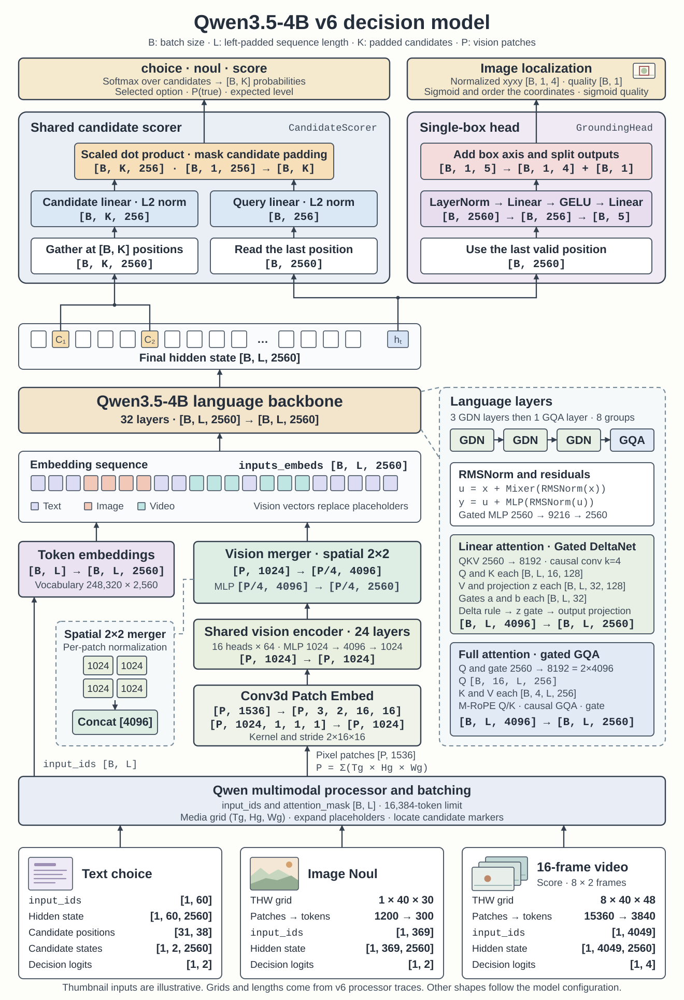
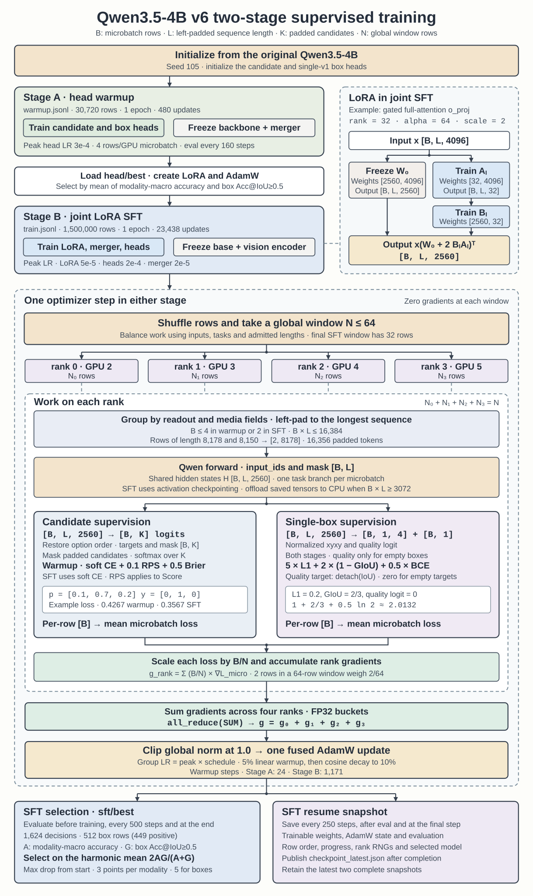

# v6 architecture, data and training

**English** · [简体中文](../../docs_zh/project-readme/multimodal-current.md)

v6 uses Qwen3.5-4B with a shared candidate scorer and a single-box head. It starts from the
original pretrained backbone, warms up both heads on 30,720 rows and jointly fine-tunes on
1,500,000 rows. The figures, recipes and comparisons below describe the November 27, 2026
snapshot and the locked source revision `4f7e0457`.

Follow the image example into the model and back through one optimizer update. Keep its question
ID, image reference, candidate positions and label together as you read the diagrams.
[Tutorial home](index.md) · [Image example](#input-to-model) · [CPU walkthrough](multimodal.md#cpu-walkthrough)

## v6 training data

| Input | Choice | Noul | Score | Box | Training rows | Share |
| --- | ---: | ---: | ---: | ---: | ---: | ---: |
| Text | 352,000 | 140,777 | 169,884 | 0 | 662,661 | 44.18% |
| Image | 138,643 | 113,357 | 93,213 | 141,562 | 486,775 | 32.45% |
| Video | 111,212 | 97,087 | 142,265 | 0 | 350,564 | 23.37% |
| Audio | 0 | 0 | 0 | 0 | 0 | 0.00% |
| Total | 601,855 | 351,221 | 405,362 | 141,562 | 1,500,000 | 100% |

The 64 modality/task pairs cover 31 text, 21 image and 12 video tasks. The smallest has
1,039 rows. The source column has 826 distinct values. The 30,720 warmup rows are sampled
from the training set. An input modality identifies what the model reads, an output type
identifies how it answers, and a task describes what it decides. For image rows the overall
share is `486,775 / 1,500,000 ≈ 32.45%`, while the task appendix uses the image count as
its denominator. [Complete request examples](multimodal-current-io-examples.md) · [Task excerpts](multimodal-current-examples.md)

### Data quality changes

- **Probability and tense labels.** Reworded 3,285 questions across 11 sources as judgments
  about a random annotator, preserving the original distributions. Corrected three SentEval
  tense labels and replaced one ambiguous row.
- **Agent actions.** Rebalanced the When2Call subset to 2,798 calls and 2,798 non-calls,
  excluding 666 negatives with empty tool lists. Other non-call trajectories retain context,
  tools and reference actions from training data from Nemotron, ToolACE and UltraData.
- **Video ratings.** Added 5,606 LIVE-LSVQ and 3,385 DIVIDE-MaxWell videos with human MOS
  ratings. Unique video rating media increased from 57,420 to 66,411.
- **Single boxes.** Replaced highly redundant boxes with Flickr30K Entities and DocLayNet
  phrase or layout annotations. Unique localization media increased from 74,953 to 94,953.

The audit checked row counts, duplicate IDs, exact requests and media references across the
training file. Its stratified review covered 826 sources and 16,303 rows. A memory preflight
scanned admitted lengths and media headers and reran 6,767 long or media inputs. The short SFT
load test recorded up to 21,738 MiB on an idle RTX 4090.

The local dataset directory is `multimodal-data/open-jev-omni-qwen-filtered-v6/`.
`manifest.json` pins split digests. `SOURCE_TOTALS.csv`, `MODALITY_TYPE_DISTRIBUTION.csv`
and `TASK_DISTRIBUTION.csv` store counts. `provenance/` stores sources and audit records.
The trainer reads `native/`.

### Compare the v1 and v6 mixtures

| Statistic | v1 | v6 |
| --- | ---: | ---: |
| Training rows | 1,337,263 | 1,500,000 |
| Image and video share | 33.56% | 55.82% |
| Score share | 6.27% | 27.02% |
| Source count | 772 | 826 |
| Modality/task pairs | 42 | 64 |

Both runs processed 32,000 rows in their first 500 updates. Text choice exposure went from
15,241 to 7,553, while Score rose from 1,978 to 8,697. To isolate mixture effects, align
task exposure, starting heads and the learning-rate schedule.

## Inputs and targets

Each v6 JSONL row contains a System One-style `request` with one question. `expected`
or `gold` provides supervision. Image references resolve through `request.assets` and video
through `request.video` and `media_files`. [Pinned loader source](https://github.com/2351548518/laya/blob/4f7e045725adf8c7c7067dfc404de1e54f68b05b/laya/multimodal_data.py#L42)

| Type | Question | Training target | Output |
| --- | --- | --- | --- |
| `choice` | `instructions` and named `criteria` | Candidate key or distribution | `choice` and `probabilities` |
| `noul` | Test a condition | Boolean or `false`/`true` distribution | `noul` as P(true) |
| `score` | Ordered `criteria` | Level index, fractional level or source distribution | Expected level `score`, `probabilities` and `legend` |
| `box` | One image and a referring phrase | Normalized `left/top/right/bottom` with `confidence: null` | One box and estimated IoU |

`gold[qid]` takes precedence. For a fractional level of 2.4 the target puts 0.6 on level 2
and 0.4 on level 3. `criteria` defines the canonical order and `option_orders` maps display
positions to canonical indices.

<a name="input-to-model"></a>

### Follow one record

This compact image-choice example shows the media binding and target.

```json
{
  "request": {
    "model": "multimodal",
    "state": ["scene", "Current view from the packing station"],
    "assets": {"scene": {"type": "image", "part": "photo"}},
    "questions": {
      "action": {
        "type": "choice",
        "instructions": "Decide what to do next.",
        "criteria": {"continue": "continue packing", "inspect": "inspect the package"}
      }
    }
  },
  "media_files": {"photo": "images/package.jpg"},
  "expected": {"action": "inspect"}
}
```

1. `normalize_record` resolves `media_files.photo` relative to the JSONL directory.
2. `record_input` binds `scene` in the state to `assets.scene.part` and the file named
   `photo`. It places referenced images at their positions in the request.
3. `MultimodalAgent._prepare` renders the options, decodes media and runs the processor.
   Candidate positions are located after media token expansion. Requests over 16,384 tokens
   fail the context check before entering the training forward pass.
4. The candidate scorer produces logits. Training restores canonical option order and
   uses the `inspect` target `[0, 1]`. Prediction returns the selected option and distribution
   under `answers.action`.

[Read an original row](multimodal-current-io-examples.md#read-original-row) · [Upload an image](multimodal.md#systemone-http)

The visual-only video rows set `video_audio: false` and use 4, 8 or 16 frames. The following
shapes were measured when replaying all 30 example requests on the locked processor.
The grid order is time, height and width. [Processor trace](assets/processor-trace.json)

| Example | `input_ids` | Vision grid | Candidate positions |
| --- | --- | --- | --- |
| Text choice | `[1, 60]` | — | `[31, 38]` |
| Image Noul | `[1, 369]` | `[1, 40, 30]` | `[334, 347]` |
| Video Score, 16 frames | `[1, 4049]` | `[8, 40, 48]` | `[3983, 3997, 4011, 4027]` |
| Image Box | `[1, 293]` | `[1, 26, 40]` | — |

<a name="architecture"></a>

## Architecture

[](assets/architecture.en.svg)

Read from bottom to top. Text and visual inputs form one `[B, L, 2560]` sequence. Each question
then uses the candidate or single-box branch. `C₁` and `C₂` denote candidate positions, and
`hₜ` denotes the last valid state. [SVG](assets/architecture.en.svg) · [PNG](assets/architecture.en.png)

### From visual patches to language tokens

`B` is batch size, `L` the left-padded sequence length, and `K` the padded candidate count.
A visual tensor's patch count `P` is the sum of `Tg × Hg × Wg` for its media grids. Each patch
has three channels, two time slices and `16 × 16` pixels, so its flat width is `1536`.
A still image supplies both time slices. A 16-frame video uses eight temporal cells.

The image Noul grid `[1, 40, 30]` yields 1,200 patches. Conv3d projects them to width 1024,
which all 24 visual layers preserve. The merger normalizes each patch and concatenates
spatial groups of four into width 4096. Its MLP maps `4096 → 4096 → 2560`.

```text
[1200, 1536] → [1200, 3, 2, 16, 16] → [1200, 1024, 1, 1, 1]
             → [1200, 1024] → [300, 4096] → [300, 2560]
```

The 300 merged vectors replace placeholders in the token embeddings. There are 69 other
positions, giving `[1, 369, 2560]`. In the 16-frame video example, `8 × 40 × 48` gives
15,360 patches, then 3,840 visual tokens. Adding 209 other positions, including timestamps,
gives `[1, 4049, 2560]`.

| Quantity | Image Noul example | Computation |
| --- | ---: | --- |
| Patches `P` | 1,200 | `1 × 40 × 30` |
| Vision tokens | 300 | One token per `2 × 2` spatial patch group |
| Sequence length `L` | 369 | 300 visual positions and 69 text or template positions |

Use `image_grid_thw` or `video_grid_thw` to calculate patch counts and `input_ids_shape`
to confirm the final token count. [Measured processor shapes](assets/processor-trace.json)

### Inside the language backbone

The 32 layers form eight groups of three Gated DeltaNet layers and one gated full-attention
layer. DeltaNet's fused projection has width `8192 = 2048 + 2048 + 4096`, split into 16
query heads, 16 key heads and 32 value heads of width 128. Full attention uses 16 query heads
and four key/value heads of width 256. Both merge to `[B, L, 4096]` then project to
`[B, L, 2560]` for the residual.

The gated MLP projects to `[B, L, 9216]`, multiplies the up branch by the SiLU gate, and
projects down to `[B, L, 2560]`. The final RMSNorm keeps that shape for both readouts.

### Shared candidate scorer

`candidate_positions` locates each rendered `Candidate N: … ->` marker. The backbone
produces `last_hidden_state [B, L, 2560]` without the language-model generation head.
Left padding aligns each input's final valid position. The query is `[B, 2560]` and the
gathered candidates are `[B, K, 2560]`. Separate projections and L2 normalization yield
`[B, 1, 256]` and `[B, K, 256]`. A scaled dot product gives `[B, K]`, with padded slots
masked. The two image Noul markers at 334 and 347 yield `[1, 2]` logits.

Choice, Noul and Score share this scorer. Softmax over candidates yields a distribution.
Choice reads its maximum, Noul reads P(true), and Score takes the expected level index.
Local Python `answer_confidence` is the top probability. HTTP serializes each field
according to the endpoint's contract.
[Candidate scorer source](https://github.com/2351548518/laya/blob/4f7e045725adf8c7c7067dfc404de1e54f68b05b/laya/multimodal_readout.py#L11) · [HTTP confidence](../http-api.md#confidence-three-numbers-not-interchangeable)

### Single-box readout

The compact `single-v1` head uses `grounding_slots=1`. It reads the final valid state using
the attention mask. LayerNorm preserves `[B, 2560]`. A linear layer and GELU produce
`[B, 256]`, and the final linear layer gives `[B, 5]`. With a singleton axis, `[B, 1, 5]`
splits into `[B, 1, 4]` coordinates and `[B, 1]` quality logits. Apply sigmoid and order
the coordinates. Sigmoid on the quality logit estimates IoU. For a 640×480 image,
`[0.1, 0.2, 0.6, 0.8]` maps to `[64, 96, 384, 384]` in pixels.
[Single-box API](../grounding.md)

Native output has zero generated tokens. Several questions on one state can share decoded media
and compatible Qwen visual features.

<a name="training"></a>

## Two supervised stages

[](assets/training.en.svg)

Read the diagram downwards. Follow the frozen and trainable weights in each stage, then the
LoRA projection and four-rank optimizer step. The recorded run used physical GPUs 2–5,
`models/pretrained/Qwen3.5-4B`, and seed 105 before initializing the heads.
[SVG](assets/training.en.svg) · [PNG](assets/training.en.png)

| Item | Head warmup | Joint LoRA SFT |
| --- | --- | --- |
| Input | 30,720 `warmup.jsonl` rows | 1,500,000 `train.jsonl` rows |
| Updates | 480 | 23,438 |
| Global batch and epochs | 64, one epoch | 64, one epoch |
| Microbatch per GPU | Up to 4 | Up to 2 |
| Context and padded microbatch limit | 16,384 tokens | 16,384 tokens |
| Updated weights | Candidate and box heads | Language LoRA, visual merger and both heads |
| Decision objective | Soft CE + 0.1 RPS + 0.5 Brier | Soft CE |
| Peak rates | Heads `3e-4` | LoRA `5e-5`, heads `2e-4`, merger `2e-5` |
| Development evaluation | Every 160 steps | Every 500 steps |
| Optimizer snapshots | Every 160 steps | Every 250 steps, at evaluation and at the end |

The warmup freezes the backbone. SFT loads `head/best` and creates fresh adapter and optimizer
state. The language adapters use `rank=32` and `alpha=64`. The vision encoder stays frozen while
the merger trains. Both stages use fused AdamW, 5% linear warmup and cosine decay to 10%
of peak learning rate. [Head configuration](assets/head-config.json) · [SFT configuration](assets/sft-config.json)

### LoRA shapes and gradients

In a full-attention `o_proj`, 16 query heads of 256 features produce `x [B, L, 4096]`.
The original frozen `W₀ [2560, 4096]` and the LoRA path both output `[B, L, 2560]`.
`A [32, 4096]` maps to `[B, L, 32]` and `B_L [2560, 32]` restores width 2560. Add
the low-rank result with scale `64 / 32 = 2`. Backpropagation computes gradients of the
same shapes as A and B_L. That is 212,992 adapter weights for this layer, compared with
10,485,760 frozen projection weights.

<a name="worked-losses"></a>

### Worked losses

Decision logits, targets and masks use `[B, K]`. The box branch uses `[B, 1, 4]` coordinates
and `[B, 1]` quality logits. Each microbatch averages its example losses.

- **Choice.** Predicted probabilities `[0.1, 0.7, 0.2]` with the second label give
  `−ln(0.7) ≈ 0.3567`. Brier is `0.14`. Warmup adds half of Brier for a loss near `0.4267`.
- **Score.** Prediction `[0.1, 0.5, 0.4]` and target `[0, 0.6, 0.4]` give soft CE
  near `0.7824`, Brier `0.02` and normalized RPS `0.005`. For RPS the first two
  cumulative probabilities differ by `0.1` and `0`, so the mean square is `0.005`.
- **Box.** Target `[0.1, 0.2, 0.6, 0.8]` and prediction `[0.2, 0.2, 0.7, 0.8]` give
  coordinate L1 of `0.2` and IoU/GIoU of `2/3`. The objective is
  `5 × L1 + 2 × (1 − GIoU) + 0.5 × BCE`. BCE fits the quality logit to the detached IoU.
  At a quality logit of zero the total is about `2.0132`. Empty boxes supervise quality at zero.

Open the CPU walkthrough and compare its `worked_calculations` with these results.
[CPU walkthrough](multimodal.md#cpu-walkthrough) · [Training API](../reference/train.md)

<a name="optimizer-step"></a>

### One optimizer update

1. Read the next global window of up to 64 rows. The primary rank validates the file and shares
   its offset index. Admitted lengths and modality help assign work to four ranks.
2. Pack compatible requests by actual length. Lengths 8,178 and 8,150 pad to `[2, 8178]`,
   or 16,356 tokens, and the backbone emits `[2, 8178, 2560]`. Lengths 5,000 and 10,000
   would need 20,000 padded tokens together and run separately.
3. Permute order-safe options and map logits back for supervision. Multiply each microbatch
   mean by `B/N`, where `N` is the current global window size. A two-row microbatch in a
   full window weighs `2/64`. The final SFT window has 32 rows.
4. Sum the accumulated gradients across ranks in FP32, clip at norm 1.0 and run AdamW once.
   SFT checkpoints activations and offloads saved tensors at 3,072 padded tokens. The
   Qwen chunk-scan optimization affects the training gradient path.

The optimizer step advances once per global update. The arithmetic is
`30,720 / 64 = 480` for warmup and `ceil(1,500,000 / 64) = 23,438` for SFT.
[Train source interface](../reference/train.md) · [Read the run log](multimodal.md#resume)

## Selection, evaluation and resume

`decision_dev.jsonl` has 1,624 decisions. The box split holds 23,269 records, and the
online development subset fixes 512 rows with 449 positive boxes. Report both counts with
IoU metrics. Warmup selects by a joint metric. The SFT selector takes the harmonic mean
of modality-macro decision accuracy and box Acc@IoU≥0.5. Relative to the initial SFT
checkpoint, a best model can lose at most 3 points in each decision modality and 5 points
in box accuracy.

`checkpoint_latest.json` identifies a recoverable optimizer snapshot with model state,
optimizer, sample order, per-rank RNG state, evaluation history and run identity. The
trainer keeps the last two complete snapshots. [Resume](multimodal.md#resume)

<a name="matched-development"></a>

### Matched development results

These November 27, 2026 measurements use the same 1,624 decisions and 449 positive boxes.
Later results are available in the run's development entries, labelled `DEV` in the current
trainer and `GROUNDING DEV` in the archived v6 logs.

| Checkpoint | Decision accuracy | Box Acc@IoU≥0.5 |
| --- | ---: | ---: |
| v6 SFT start | 61.95% | 24.28% |
| v6 SFT step 500 | 75.92% | 39.64% |
| v6 SFT step 1,000 | 78.63% | 40.31% |
| v1 final replay | 86.15% | 76.39% |

Step 500 improved over the v6 start by 13.97 points on decisions and 15.36 on boxes.
The v1 reference had 20,895 completed steps. Compare data mixtures with a fixed
initialization, update budget and learning-rate schedule.

The frozen evaluation inventory has 23 files, with 130,608 rows across 22 JSONL files.
It includes MMLU-Pro, MMMU multiple choice, RefCOCO and agent decisions. The 2,971
calibration rows serve probability fitting after training.
[Evaluation commands](multimodal.md#evaluate)
