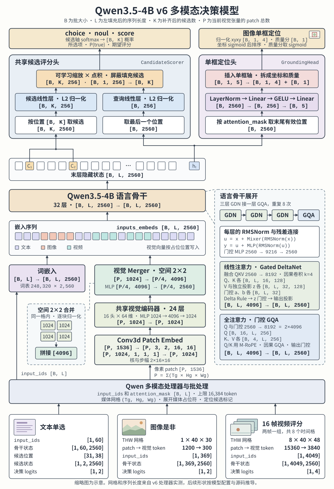
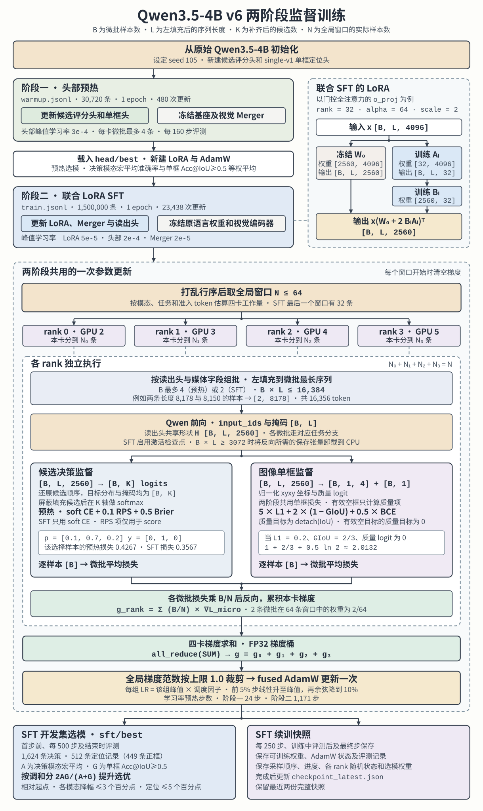

# 从一条数据读懂 v6 架构与训练

v6 使用 **Qwen3.5-4B、共享候选评分头和单框定位头**。这一轮从原始预训练基座初始化，先在 30,720 条记录上预热头部，再用 1,500,000 条记录联合微调。本文依据 2026 年 11 月 27 日的 v6 数据清单、运行配置和源码提交 `4f7e0457`。

先沿着图像单选样例读到模型，再从损失反向读到一次参数更新。阅读时可以把同一条记录的题目 ID、媒体引用、token 位置和标签写在一起。这样看图时就能认出每一层拿到的输入。 [教程首页](index.md) · [图像单选](#input-to-model) · [模型图](#architecture) · [训练图](#training) · [CPU 演示](multimodal.md#cpu-walkthrough)

## v6 训练数据

| 输入模态 | Choice 单选 | Noul 是非 | Score 评分 | Box 单框 | 训练记录 | 全量占比 |
| --- | ---: | ---: | ---: | ---: | ---: | ---: |
| 文本 | 352,000 | 140,777 | 169,884 | 0 | 662,661 | 44.18% |
| 图像 | 138,643 | 113,357 | 93,213 | 141,562 | 486,775 | 32.45% |
| 视频 | 111,212 | 97,087 | 142,265 | 0 | 350,564 | 23.37% |
| 音频 | 0 | 0 | 0 | 0 | 0 | 0.00% |
| 合计 | 601,855 | 351,221 | 405,362 | 141,562 | 1,500,000 | 100% |

细任务以「模态 × 任务」计数，包括 31 个文本任务、21 个图像任务和 12 个视频任务。最小的细任务有 1,039 条。来源字段共有 826 种取值。预热集从全量训练集重新抽取，共 30,720 条。

读表时先分清三个层级。输入模态描述模型读到的材料，`choice` 等输出类型描述回答方式，`task` 描述本样本要学的场景。图像计数和图像空间关系都可以是 `choice`，也可以来自不同来源。表中的图像比例以全量为分母，`486,775 ÷ 1,500,000 ≈ 32.45%`。细任务附录用各自模态为分母。 [按题型看请求](multimodal-current-io-examples.md) · [按任务看覆盖](multimodal-current-examples.md)

### 本版数据质量变更

- **概率和时态标签**。将 11 个来源的 3,285 道比例题改写为对随机抽取的一位标注者做二元判断，并保留来源标签。按 SentEval 原始任务定义纠正 3 条时态标注，另替换 1 条歧义样本。
- **Agent 动作**。重整 When2Call 的官方训练样本，将本组调用和不调用分别设为 2,798 条，移除 666 条空工具列表负例。其余补充的非调用轨迹保留上下文、可用工具与参考动作，来自 Nemotron、ToolACE 和 UltraData 的训练来源。
- **视频评分**。加入 5,606 条 LIVE-LSVQ 和 3,385 条 DIVIDE-MaxWell 的原始训练视频与人工 MOS。视频评分的唯一媒体数从 57,420 增至 66,411。
- **单框定位**。以 Flickr30K Entities 和 DocLayNet 的原始短语或布局标注替换高冗余框。定位的唯一媒体数从 74,953 增至 94,953。

全量训练文件核验了记录数、重复 ID、相同请求以及媒体引用。发布清单的分层审核涵盖 826 个来源和 16,303 条记录。运行前的显存复查另扫描了全部准入长度和媒体头，并实际复跑 6,767 条长输入和多媒体样本。在空闲 RTX 4090 上按本轮 SFT 配置做短压测，最高采样显存为 21,738 MiB。

本地数据根目录为 `multimodal-data/open-jev-omni-qwen-filtered-v6/`。其中 `manifest.json` 固定分片哈希，`SOURCE_TOTALS.csv`、`MODALITY_TYPE_DISTRIBUTION.csv` 和 `TASK_DISTRIBUTION.csv` 保存计数，`provenance/` 保存原始来源、变更和审核记录。训练读取该目录的 `native/`。

### 与 v1 的配比差异

| 统计 | v1 | v6 |
| --- | ---: | ---: |
| 训练记录 | 1,337,263 | 1,500,000 |
| 图像和视频占比 | 33.56% | 55.82% |
| 评分占比 | 6.27% | 27.02% |
| 来源数 | 772 | 826 |
| 模态细任务数 | 42 | 64 |

两版前 500 步均处理 32,000 条记录。v6 的文本单选从 15,241 条减到 7,553 条，评分从 1,978 条增到 8,697 条。训练步数相同的比较还需对齐任务曝光、初始头部和学习率进程。

## 输入和监督输出

v6 的训练行使用 TypeSafe System One 风格的 `request`，并把监督目标置于同一 JSONL 行的 `expected` 或 `gold`。每个训练行有一道问题。图像通过 `request.assets` 引用本地文件，视频通过 `request.video` 和 `media_files` 对接原生视频扩展。 [加载器源码](https://github.com/2351548518/laya/blob/4f7e045725adf8c7c7067dfc404de1e54f68b05b/laya/multimodal_data.py#L42)

| 类型 | 问题字段 | 训练监督 | 模型输出 |
| --- | --- | --- | --- |
| `choice` | `instructions` 和命名的 `criteria` | 候选键或来源提供的分布 | `choice` 和 `probabilities` |
| `noul` | 是非判断指令，允许描述两个条件 | 布尔值或 `false/true` 分布 | `noul` 为真值概率 |
| `score` | 由低到高的 `criteria` | 零起始的等级、实数等级或原始分布 | 等级期望 `score`、`probabilities` 与 `legend` |
| `box` | 一张图及指代目标 | 归一化 `left/top/right/bottom`，监督置信度为 `null` | 单框与 IoU 质量估计 |

如果两者都存在，`gold[qid]` 的软分布优先。四类共同用题目 ID 把输入、目标和输出关联起来。分数 `2.4` 位于档位索引 2 和 3 之间，训练目标分别给这两个档位 0.6 和 0.4 的概率。规范标签顺序来自 `criteria`，`option_orders` 记录显示位置与规范索引的映射。 [监督目标转换](https://github.com/2351548518/laya/blob/4f7e045725adf8c7c7067dfc404de1e54f68b05b/laya/train.py#L196)

<a name="input-to-model"></a>

### 一条记录怎样进入模型

以下是便于逐行理解的图像单选示例。实际训练文件中的 30 条完整请求与监督目标在[样例附录](multimodal-current-io-examples.md)。

```json
{
  "request": {
    "model": "multimodal",
    "state": ["scene", "Current view from the packing station"],
    "assets": {"scene": {"type": "image", "part": "photo"}},
    "questions": {
      "action": {
        "type": "choice",
        "instructions": "Decide what to do next.",
        "criteria": {"continue": "continue packing", "inspect": "inspect the package"}
      }
    }
  },
  "media_files": {"photo": "images/package.jpg"},
  "expected": {"action": "inspect"}
}
```

1. `normalize_record` 相对 JSONL 所在目录解析 `photo`，记录图像占位符与本地路径的绑定，保留 `expected` 或 `gold`。
2. `record_input` 将占位符绑定到状态、指令或选项中的实际位置。前置图像列表在这里转成图像序列和文本上下文。
3. `MultimodalAgent._prepare` 渲染候选、解码媒体，再由 Qwen 处理器生成 `input_ids`、掩码和视觉张量。候选标记的位置按媒体 token 展开后的偏移计算。超过 16,384 token 的输入在传入 GPU 之前报错。
4. 决策头对候选打分，训练把分数映射回原标签顺序后计算损失。`predict()` 用概率选最大候选，并在 `answers.action` 中返回选项与分布。 [输入绑定与预处理](https://github.com/2351548518/laya/blob/4f7e045725adf8c7c7067dfc404de1e54f68b05b/laya/multimodal.py#L465)

从这一行可以练习两个查找。媒体链路是 `state` 里的 `scene` → `assets.scene.part` 的 `photo` → `media_files.photo` 的文件路径。监督链路是 `questions.action` → `expected.action` 的 `inspect` → `criteria.inspect` 的选项含义。如果规范选项顺序为 `[continue, inspect]`，训练目标就是 `[0, 1]`。部署时发送 `request` 描述的问题和图片，取响应的 `answers.action` 对照模型预测。 [图片上传实例](multimodal.md#systemone-http) · [用索引读原始记录](multimodal-current-io-examples.md#read-original-row)

视频记录把 `video_audio` 设为 `false`，使用 4、8 或 16 帧。Qwen3.5 的原生视频处理限制逐帧像素预算。可用音频的 Gemma 路径和保留的真实音频例子在[运行指南](multimodal.md#audio-and-video)与[样例附录](multimodal-current-io-examples.md#gemma-audio)。

用本轮锁定的处理器在 CPU 上复跑了全部 30 条完整请求。下表列出四种请求的实测形状。网格按时间、高、宽记录，候选位置为 token 索引。 [全部处理器记录](assets/processor-trace.json)

| 实例 | `input_ids` | 视觉网格 | 候选标记位置 |
| --- | --- | --- | --- |
| 文本单选 | `[1, 60]` | — | `[31, 38]` |
| 图像是非 | `[1, 369]` | `[1, 40, 30]` | `[334, 347]` |
| 16 帧视频评分 | `[1, 4049]` | `[8, 40, 48]` | `[3983, 3997, 4011, 4027]` |
| 图像单框 | `[1, 293]` | `[1, 26, 40]` | — |

<a name="architecture"></a>

## 模型架构

[](assets/architecture.svg)

图从下往上读。先在底部选择文本、图像或视频入口，再跟到共同的 `[B, L, 2560]` 序列，最后根据题型走到候选评分头或单框头。彩色方块示意序列位置，`C₁`、`C₂` 标出候选位置，`hₜ` 表示当前问题的末尾有效状态。点击图可放大。 [SVG 矢量图](assets/architecture.svg) · [PNG 高清图（2640 × 3856）](assets/architecture.png)

### 视觉 patch 如何变成语言 token

图中 `B` 为批大小，`L` 为左填充后的序列长度，`K` 为该批补齐后的候选数。处理器分别为图像和视频生成 patch 张量，每个张量的 `P` 为其中所有媒体网格的 `Tg × Hg × Wg` 之和。每个 patch 含 RGB 三通道、两个时间切片和 `16 × 16` 像素，展平后宽度为 `3 × 2 × 16 × 16 = 1536`。单图复制图像内容以填满两个时间切片，16 帧视频按两帧一组形成 8 个时间格。

以实测图像是非样本为例，网格 `[1, 40, 30]` 产生 1,200 个 patch。Conv3d 对每个 patch 做一次投影，共享视觉编码器的 24 层都保留 `[1200, 1024]`。Merger 先逐 patch 做 LayerNorm，再把空间上相邻的四个 1,024 维向量拼成一个 4,096 维向量。其 MLP 通过 `4096 → 4096 → 2560` 把 300 个合并向量映射到语言隐藏空间。

```text
[1200, 1536] → [1200, 3, 2, 16, 16] → [1200, 1024, 1, 1, 1]
             → [1200, 1024] → [300, 4096] → [300, 2560]
```

词表查询将 `input_ids [B, L]` 变为 `[B, L, 2560]`。上例的 300 个视觉向量按占位位置写入同一序列，另有 69 个文本、模板等位置，所以骨干读到 `[1, 369, 2560]`。16 帧视频的网格 `[8, 40, 48]` 对应 15,360 个 patch 和 3,840 个视觉 token，连同 209 个其他位置形成 `[1, 4049, 2560]`。视频的时间戳属于其他位置。 [处理器实测记录](assets/processor-trace.json) · [左填充与批处理源码](https://github.com/2351548518/laya/blob/4f7e045725adf8c7c7067dfc404de1e54f68b05b/laya/multimodal_train.py#L487)

按图核对一个样本，可以依次检查三种维度。

| 检查位置 | 图像是非样本 | 怎么算 |
| --- | --- | --- |
| patch 行数 `P` | `1,200` | 时、高、宽网格相乘，即 `1 × 40 × 30`。 |
| 视觉 token 数 | `300` | 用空间上的 `2 × 2` 个 patch 生成一个 token。 |
| 语言序列长度 `L` | `369` | 300 个位置装入视觉向量，另有 69 个位置留给文本和模板。 |

做练习时，在处理器记录中找 `image_grid_thw` 或 `video_grid_thw`，按网格计算 patch 数，再用 `input_ids_shape` 核对语言序列长度。媒体 token 的展开也解释了候选位置为何接近序列末尾。 [原始形状记录](assets/processor-trace.json)

### 语言骨干内部

32 层分为 8 组，每组依次是三层 Gated DeltaNet 和一层门控全注意力。Gated DeltaNet 的融合投影宽度为 `8192 = 2048 + 2048 + 4096`，分别拆成 16 个 Q 头、16 个 K 头和 32 个 V 头，每头 128 维。门控全注意力有 16 个查询头和 4 个键值头，每头 256 维。两种注意力合并输出头后都是 `[B, L, 4096]`，再经输出投影回到 `[B, L, 2560]`，以便和输入做残差相加。

每层 MLP 的上投影和门投影分别得到 `[B, L, 9216]`，门投影经 SiLU 后与上投影相乘，下投影再回到 `[B, L, 2560]`。末层 RMSNorm 保持同一形状，供两个读出头按位置读取。

### 共享候选评分头

`_prepare` 为每个选项渲染 `Candidate N: … ->`。`candidate_positions` 找到这些候选标记对应的 token。`_logits` 调用 `base.model(..., use_cache=False)` 得到 `last_hidden_state`。候选评分头取最后一个位置作为全局查询，并从候选标记处取每个候选的上下文向量。训练器给序列左填充，最后一个位置对齐到各样本的真实末尾。 [前向源码](https://github.com/2351548518/laya/blob/4f7e045725adf8c7c7067dfc404de1e54f68b05b/laya/multimodal.py#L642)

候选位置张量 `[B, K]` 从隐藏状态取出 `[B, K, 2560]`，全局查询为 `[B, 2560]`。两套线性层各自把最后一维变成 256，再做 L2 归一化。查询扩为 `[B, 1, 256]`，与候选向量逐元素相乘，沿 256 维求和并乘可学习的缩放系数，得到 `[B, K]` logits。填充候选由掩码屏蔽。图像是非样本在位置 334 和 347 取向量，输出 `[1, 2]`。候选数量上限为 256，`choice`、`noul` 和 `score` 共用这一个头。 [CandidateScorer](https://github.com/2351548518/laya/blob/4f7e045725adf8c7c7067dfc404de1e54f68b05b/laya/multimodal_readout.py#L11)

继续用这条图像是非题做维度练习。输入 `last_hidden_state` 是 `[1, 369, 2560]`。取末尾状态得到 `[1, 2560]` 查询，取两个标记位置得到 `[1, 2, 2560]` 候选。投影后拿一个 `[1, 1, 256]` 查询与 `[1, 2, 256]` 候选做点积。沿 256 维累加后得到两个分数，沿候选轴做 softmax 就得到本题的概率分布。

`choice` 返回最大概率的候选键。`noul` 读取 `P(true)`。`score` 将每个档位索引乘以该档概率后求和，同时保留概率分布和各档含义。在本地 Python 结果中，`answer_confidence` 表示最大概率，`confidence` 是类型对应的置信度读数。HTTP 输出按相应端点的约定序列化。 [输出解码](https://github.com/2351548518/laya/blob/4f7e045725adf8c7c7067dfc404de1e54f68b05b/laya/multimodal.py#L692)

### 单框定位头

v6 设定 `grounding_slots=1`，架构名为 `single-v1`。`GroundingHead` 用注意力掩码取得最后一个有效位置。LayerNorm 保持 `[B, 2560]`，线性层与 GELU 得到 `[B, 256]`，最后一层输出 `[B, 5]`。插入单框轴后，`[B, 1, 5]` 拆成坐标 `[B, 1, 4]` 和质量 logit `[B, 1]`。坐标经过 sigmoid 与排序，构成图像内的正宽高框。质量 logit 经 sigmoid 得到估计 IoU 的质量分。若图像宽为 640、高为 480，`[0.1, 0.2, 0.6, 0.8]` 对应像素坐标 `[64, 96, 384, 384]`。 [定位头与坐标转换](https://github.com/2351548518/laya/blob/4f7e045725adf8c7c7067dfc404de1e54f68b05b/laya/grounding.py#L41) · [单框 API](../grounding.md)

每个问题按所需的头部取结果，模型直接返回结构化答案，`output_tokens=0`。对同一请求的多道题，运行器可以复用媒体解码结果和符合条件的 Qwen 视觉特征。 [推理入口](https://github.com/2351548518/laya/blob/4f7e045725adf8c7c7067dfc404de1e54f68b05b/laya/multimodal.py#L725)

<a name="training"></a>

## 训练方式

[](assets/training.svg)

图从上往下读。先顺着左侧确认两个阶段的输入、冻结范围和阶段产物。接着看右侧一个 LoRA 线性层的维度。最后沿下半部分走完一个全局窗口，从四卡分样本到微批反向、梯度求和和参数更新。 [SVG 矢量图](assets/training.svg) · [PNG 高清图（2640 × 4432）](assets/training.png)

实际运行用物理 GPU 2、3、4、5，基座为 `models/pretrained/Qwen3.5-4B`。seed 105 在新建头部之前设置。初始化检查点、训练日志和优化器快照写入 `multimodal-runs/qwen4b-v6-fresh/`。

| 项目 | 头部预热 | 联合 LoRA SFT |
| --- | --- | --- |
| 输入 | `warmup.jsonl` 30,720 条 | `train.jsonl` 1,500,000 条 |
| 更新预算 | 480 步 | 23,438 步 |
| 全局 batch | 64，1 epoch | 64，1 epoch |
| 每张卡的微批上限 | 4 条 | 2 条 |
| 上下文及补齐后的微批 token 上限 | 16,384 | 16,384 |
| 更新参数 | 候选评分头和单框头 | 语言 LoRA、视觉 merger、候选头和单框头 |
| 决策损失 | soft CE + 0.1 RPS + 0.5 Brier | soft CE |
| 峰值学习率 | 头部 `3e-4` | LoRA `5e-5`，头部 `2e-4`，merger `2e-5` |
| 开发集评测 | 每 160 步 | 每 500 步 |
| 优化器快照 | 每 160 步 | 每 250 步，另在评测后和最终步保存 |

预热冻结基座，随后用本次预热选出的 `head/best` 初始化 SFT，并建立新的 LoRA 适配器和 AdamW 优化器。语言 LoRA 使用 `r=32`、`alpha=64`，覆盖注意力、Qwen3.5 融合投影及 MLP 的线性层。视觉编码器冻结，视觉 merger 单独训练。两阶段都使用 fused AdamW、5% 线性学习率预热和余弦衰减，末端为峰值学习率的 10%。v6 主训练的两个阶段都是监督训练。

[头部预热配置](assets/head-config.json) · [LoRA 配置](assets/sft-config.json) · [参数组和学习率源码](https://github.com/2351548518/laya/blob/4f7e045725adf8c7c7067dfc404de1e54f68b05b/laya/multimodal_objectives.py#L85)

### LoRA 的输入与梯度

以图中全注意力的 `o_proj` 为例，16 个查询头各产出 256 维注意力结果，拼成 `x [B, L, 4096]`。冻结的原权重 `W₀ [2560, 4096]` 和 LoRA 分支都输出 `[B, L, 2560]`。LoRA 用 `A [32, 4096]` 先得到 `[B, L, 32]`，再用 `B_L [2560, 32]` 恢复到 2,560 维，并把这路输出以 `64 / 32 = 2` 倍加到原投影结果。反向时 `A` 和 `B_L` 分别累积与各自权重同形状的梯度。这里形状里的 `B` 表示微批样本数。 [LoRA 安装源码](https://github.com/2351548518/laya/blob/4f7e045725adf8c7c7067dfc404de1e54f68b05b/laya/multimodal_train.py#L427)

忽略偏置，这一个原投影的矩阵有 `2560 × 4096 = 10,485,760` 个权重，LoRA 分支训练 `32 × 4096 + 2560 × 32 = 212,992` 个矩阵参数。两个分支输出形状相同，可以逐元素相加。整轮 SFT 的可训练参数还包括其他语言适配器、视觉 merger 和两个读出头。

<a name="worked-losses"></a>

### 损失怎样计算

一个决策微批的 logits、目标分布和候选掩码都是 `[B, K]`。沿候选轴算出每条记录的损失，再对 `B` 条取均值。单框微批使用 `[B, 1, 4]` 坐标和 `[B, 1]` 质量 logits，以同样的样本均值作为该微批的损失。

**选择例子。** 三个候选的预测概率为 `[0.1, 0.7, 0.2]`，正确候选是第二项。soft CE 为 `-ln(0.7) ≈ 0.3567`。预热还计入 Brier，平方误差和为 `0.14`，该样本的损失约为 `0.4267`。

**评分例子。** 目标档位概率为 `[0, 0.6, 0.4]`，预测为 `[0.1, 0.5, 0.4]`。soft CE 约为 `0.7824`。预热阶段再计入归一化 RPS 和 Brier，分别约为 `0.005` 和 `0.02`。RPS 按档位累积概率计算，使跨多个等级的偏差受到更大惩罚。

**定位例子。** 标注框为 `[0.1, 0.2, 0.6, 0.8]`，预测框为 `[0.2, 0.2, 0.7, 0.8]`。坐标 L1 和为 0.2，IoU 与 GIoU 均为 2/3。单框损失是 `5 × L1 + 2 × (1 − GIoU) + 0.5 × BCE`。最后一项用分离梯度后的 IoU 监督质量 logit。若质量 logit 为 0，合计约为 `2.0132`。空框样本只给质量头提供零目标。

可以拿评分例子对照 CPU 输出复算。前两道档位边界的预测累计概率是 `0.1`、`0.6`，目标累计概率是 `0`、`0.6`。将两处差值平方再取平均，即 `(0.1² + 0²) ÷ 2 = 0.005`。把这个结果与 `worked_calculations.score_parts.ordinal_rps` 对照，再比较预热与 SFT 配置里的 `decision_ordinal_weight`。 [CPU 输出读法](multimodal.md#cpu-walkthrough)

[决策目标函数](https://github.com/2351548518/laya/blob/4f7e045725adf8c7c7067dfc404de1e54f68b05b/laya/multimodal_objectives.py#L32) · [定位目标函数](https://github.com/2351548518/laya/blob/4f7e045725adf8c7c7067dfc404de1e54f68b05b/laya/grounding.py#L141)

<a name="optimizer-step"></a>

### 一次参数更新

当前代码在 `laya/train.py` 把硬标签和软标签转换成候选概率，再统一执行决策和单框训练。下方源码链接对应 v6 运行时锁定的版本。
[当前训练接口](../reference/train.md)

1. 读取一个最多 64 条记录的优化器窗口。`_rank_window` 根据准入长度和模态在四个 rank 间分配工作量。大 JSONL 由主 rank 校验并建立偏移索引，再共享给其余 rank。
2. 每张卡使用实际处理后的序列长度组批。补齐后的 `B × L` 上限为 16,384。两条 8,178 与 8,150 token 的同类样本可组成 `input_ids [2, 8178]`，占 16,356 token，骨干输出 `[2, 8178, 2560]`。如果两条样本分别长 5,000 和 10,000 token，合批后要补齐到 `[2, 10000]`，因此分开执行。
3. 对可交换的 Choice 候选重排，计算损失前按原始次序还原 logits。每个微批的平均损失先乘 `B/N` 再反向，其中 `N` 是全局窗口的实际样本数。完整窗口中两条微批的权重是 `2/64`，SFT 最后一个窗口有 32 条，分母相应为 32。
4. 四张卡以 FP32 对累积梯度求和，按范数上限 1.0 裁剪，再更新一次 AdamW。SFT 使用激活检查点。补齐后的微批达到 3,072 token 时，反向所需的保存张量卸载到 CPU。Qwen 的分块扫描优化作用于训练梯度路径。

当前源码在 `laya/train.py` 划分微批并更新参数。`laya/multimodal_distributed.py` 中的
`DistributedContext.sum_gradients` 负责跨卡求和。[训练接口](../reference/train.md)

看到训练日志的 `grounding step` 递增一次，就表示四张卡一起完成了这套流程。用 `30,720 ÷ 64 = 480` 核对预热步数，用 `ceil(1,500,000 ÷ 64) = 23,438` 核对 SFT 步数。CPU 演示可以单独查看两个头的反向结果，真实四卡日志可以用来识别优化器步和开发集评测。 [运行演示](multimodal.md#cpu-walkthrough) · [读训练日志](multimodal.md#resume)

## 选模、评测与续训

- `decision_dev.jsonl` 包含 1,624 条决策，报告总体、按模态和按类型的准确率，以及 NLL、Brier 和 ECE。`dev.jsonl` 共有 23,269 条定位验证记录。SFT 在线评测固定抽取 512 条，其中 449 条是正框，用于计算平均 IoU 和 Acc@IoU≥0.5。
- 预热按决策模态宏平均与定位指标的联合分选模。SFT 对单框 Acc@IoU≥0.5 与决策模态宏平均取调和平均，从 `sft/initial` 的评测起比较。保存 `best` 还要求各模态决策相对基线退化不超过 3 个百分点，定位退化不超过 5 个百分点。
- `checkpoint_latest.json` 指向最近的可恢复快照。快照包含训练权重、优化器、采样顺序、各 rank 随机状态、历史评测和运行标识。训练器保留最近两个完整快照。续训使用原模型、数据、配置和 rank 数。 [本地启动和续训](multimodal.md#resume) · [快照实现](https://github.com/2351548518/laya/blob/4f7e045725adf8c7c7067dfc404de1e54f68b05b/laya/_grounding_checkpoint.py#L38)

<a name="matched-development"></a>

### 已核验的同集结果

以下为 2026 年 11 月 27 日留存的同一 v6 开发集结果。v1 final 复跑了 1,624 条决策和相同的 449 个正框。训练仍在推进，更新的评测写在本地 `sft.log` 的 `GROUNDING DEV` 行。

| 检查点 | 决策准确率 | 单框 Acc@IoU≥0.5 |
| --- | ---: | ---: |
| v6 SFT 起点 | 61.95% | 24.28% |
| v6 SFT 第 500 步 | 75.92% | 39.64% |
| v6 SFT 第 1,000 步 | 78.63% | 40.31% |
| v1 final 同集复测 | 86.15% | 76.39% |

看这张表时，先沿 v6 的行观察同一评测集上的变化。以第 500 步为例，决策准确率比 SFT 起点高 13.97 个百分点，定位高 15.36 个百分点。再看 v1 final 的一行，它给出了同一分片上的已完成训练参照。要判断另一次训练的结果是否可比，先核对评测文件、正框数量、训练步数和决策聚合方式。 [复跑与读指标](multimodal.md#evaluate)

v1 final 来自已完成 20,895 步的训练。比较数据配比的独立效果需要固定起点、更新预算与学习率进程。v6 冻结评测资产共有 23 个文件，其中 22 个 JSONL 共 130,608 条。除训练中使用的验证和校准分片，还保留 MMLU-Pro、MMMU 多选、RefCOCO 系列和 Agent 决策等独立评测。 `calibration.jsonl` 的 2,971 条记录用于模型完成后的概率校准。 [校准与评测命令](multimodal.md#evaluate)
