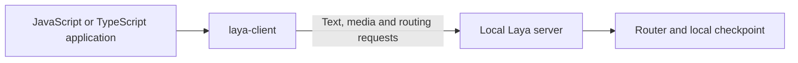

# TypeScript SDK 契约

[English](../docs/typescript-sdk.md) · **简体中文**

`laya-client` 是自托管 `laya-multimodal-serve` 的 HTTP 客户端，独立于 Python 推理包发布。

## 组件职责

| 组件 | 职责 |
| --- | --- |
| `sdk/typescript` | 请求与响应类型、预设、校验、fetch、错误和取消 |
| `laya_multimodal/serve.py` | HTTP、Bearer 认证、健康检查、请求限制 |
| `laya_multimodal/decisions/routing.py` | 选择和加载检查点、路由 |
| `laya_multimodal/models/multimodal.py` | 本地媒体预处理、PyTorch 推理和答案 |
| `laya_multimodal/decisions/presets.py` | 生成五套 TypeScript 预设的来源 |

SDK 提供 `predict`、`predictBatch`、`predictImageAssets`、`predictMultimodal`、
`route` 和 `health`。发布 ESM、CommonJS 与类型声明，保留推断出的题目 ID 和候选标签。

## 公共契约

文本请求包含 `state` 与 `questions`。未指定 `model` 时由部署的路由器选择检查点。
候选标签数组在发送前转换成说明为 `null` 的映射。响应保留 `model`、`answers` 和
`usage`，选择和评分包含概率分布与置信度，评分还带 `legend`。扩展响应中可有
`answer_confidence`、`abstention`、`abstention_threshold` 和 `low_confidence`。
客户端会校验出现的可选字段。 [HTTP 置信度](http-api.md#confidence-three-numbers-not-interchangeable)

| 方法 | 路径 |
| --- | --- |
| `predict` | `POST /v1/systemone` |
| `predictBatch` | `POST /v1/systemone/batch` |
| `predictImageAssets` | `POST /v1/systemone`，带命名图片资产 |
| `predictMultimodal` | `POST /v1/multimodal` |
| `route` | `POST /v1/route` |
| `health` | `GET /health` |

`route(state, questions = {}, options = {})` 读取部署的路由快照。`model`、`repo`、`reason`
描述选择。`explain: true` 时应返回 `diagnostic`，可为 `null`。本地只检查路由用到的字段与
问题形状。路由成功后，服务仍会在预测时检查完整请求。自定义钩子可改变诊断，应用按实际内容记录。

| 客户端选项 | HTTP 字段 |
| --- | --- |
| `model` | `model` |
| `task` | `task` |
| `lang` | `lang` |
| `langGuess` | `lang_guess` |
| `maxLen` | `max_len` |
| `headMaxLen` | `head_max_len` |
| `minConfidence` | `min_confidence` |

客户端只发送调用方给出的控制。空 `task`、非正整数的预算、无效阈值或空阈值映射会在发送前报错。
认证后的 `/health` 有 `status`、`loaded`、`revisions`、`device`、`device_is_preference`、
`checkpoint_devices`、`cpu_fallbacks`。开启空闲卸载时增加 `idle_unload_seconds` 和
`idle_seconds`。配置密钥的服务给匿名探针返回 `{"status": "ok"}`，客户端接受此存活响应。
[健康接口](http-api.md#get-health)

响应错误由 `LayaAPIError` 保留服务端详情。使用最终服务 URL 设置 `baseURL`，重定向直接报请求
错误。每次调用发出一个请求。取消或超时结束客户端等待，已开始的服务器工作可能继续。

## 批量预测

`predictBatch(states, questions, options)` 发送非空状态数组和共享题目。`results[i]`
与 `states[i]` 对应。`total_usage` 只包含输入和输出 token 汇总，单条截断状态在每条的
`usage` 中。整批通过校验后才返回，格式错误的条目在 `LayaResponseError` 中给出索引。

`batchSize` 和 `sortByLength` 映射到 `batch_size` 和 `sort_by_length`，控制服务端推理，
返回次序仍与输入一致。批次形状会影响浮点运算。分批与重试由应用决定，服务器上限由部署配置执行。

## 媒体预测

`predictMultimodal` 使用服务器配置的原生检查点，接受一个图片、音频或视频文件以及题目集。
`state` 提供附加上下文。`maxLen`、`minConfidence` 映射到 `max_len`、`min_confidence`。
返回值可含单框结果和 `usage.forward_passes`。 [类型化示例](multimodal-clients.md#typescript)

## 验证与发布

在 `sdk/typescript` 运行 `npm test`、`npm run test:integration` 和
`npm run test:package`。测试覆盖传输、选项验证、ESM/CommonJS、响应及错误类型，以及
用离线小检查点对照直接 Python 推理。扩展与严格模式的批量对照使用同样的前向批次。
小检查点用于验证接口与数值一致性。
[安装、示例及发布命令](https://github.com/2351548518/laya/blob/main/sdk/typescript/README.md)
